# Relacionamentos

Lista plana de arestas `origem → destino` (FK física, join JPA/HQL, ou relação lógica validada). Diagramas Mermaid por domínio logo abaixo.

| Origem | Colunas | Destino | Colunas | Card. | Tipo | Status |
|---|---|---|---|---|---|---|
| FDN_RECENTLY_VIEWED | NUM_DOCUMENT | DOCUMENTO | NR_DOCUMENTO | N:1 | logical-probable | probable |
| FDN_RECENTLY_VIEWED | NUM_PROCESS_INSTANCE | PROCES_WORKFLOW | NUM_PROCES | N:1 | logical-probable | probable |
| FDN_DIGITALSIGNATURE | TENANT_ID | FDN_TENANT | TENANT_ID | N:1 | physical-fk | confirmed |
| FLUIG_AUDIT | USER_TENANT_ID | FDN_USERTENANT | USER_TENANT_ID | N:1 | logical-probable | probable |
| FLUIG_AUDIT | TENANT_ID | FDN_TENANT | TENANT_ID | N:1 | logical-probable | probable |
| FLUIG_AUDIT_CONFIG | TENANT_ID | FDN_TENANT | TENANT_ID | 1:1 | logical-probable | probable |
| ACTIVITY_DIM_CAP | COMPANYID, PROCESSID, PROCESSVERSION | PROCES_VERSION_DIM_CAP | COMPANYID, PROCESSID, PROCESSVERSION | N:1 | logical-probable | probable |
| FACT_ACTIVITY_COST_CAP | ACTIVITYID, COMPANYID, PROCESSID, PROCESSVERSION | ACTIVITY_DIM_CAP | ACTIVITYID, COMPANYID, PROCESSID, PROCESSVERSION | N:1 | logical-probable | probable |
| FACT_ACTIVITY_COST_CAP | COMPANYID, DAYID, MONTHID, PROCESSID, PROCESSVERSION, USERSEQUENCE, YEARID | FACT_PROCES_COST_CAP | COMPANYID, DAYID, MONTHID, PROCESSID, PROCESSVERSION, USERSEQUENCE, YEARID | 1:1 | logical-probable | probable |
| FACT_ACTIVITY_COST_CAP | COMPANYID, DAYID, MONTHID, PROCESSID, PROCESSVERSION, USERSEQUENCE, YEARID | FACT_PROCES_VOLUME_CAP | COMPANYID, DAYID, MONTHID, PROCESSID, PROCESSVERSION, USERSEQUENCE, YEARID | 1:1 | logical-probable | probable |
| FACT_ACTIVITY_COST_CAP | COMPANYID, DAYID, MONTHID, YEARID | TIME_DIM_CAP | COMPANYID, DAYID, MONTHID, YEARID | N:1 | logical-probable | probable |
| FACT_ACTIVITY_COST_CAP | COMPANYID, USERSEQUENCE | USER_DIM_CAP | COMPANYID, USERSEQUENCE | N:1 | logical-probable | probable |
| FACT_ACTIVITY_COST_CAP | USERCODE | FDN_USERTENANT | USER_CODE | N:1 | logical-probable | probable |
| FACT_ACTIVITY_VOLUME_CAP | ACTIVITYID, COMPANYID, PROCESSID, PROCESSVERSION | ACTIVITY_DIM_CAP | ACTIVITYID, COMPANYID, PROCESSID, PROCESSVERSION | N:1 | logical-probable | probable |
| FACT_ACTIVITY_VOLUME_CAP | COMPANYID, DAYID, MONTHID, PROCESSID, PROCESSVERSION, USERSEQUENCE, YEARID | FACT_PROCES_COST_CAP | COMPANYID, DAYID, MONTHID, PROCESSID, PROCESSVERSION, USERSEQUENCE, YEARID | 1:1 | logical-probable | probable |
| FACT_ACTIVITY_VOLUME_CAP | COMPANYID, DAYID, MONTHID, PROCESSID, PROCESSVERSION, USERSEQUENCE, YEARID | FACT_PROCES_VOLUME_CAP | COMPANYID, DAYID, MONTHID, PROCESSID, PROCESSVERSION, USERSEQUENCE, YEARID | 1:1 | logical-probable | probable |
| FACT_ACTIVITY_VOLUME_CAP | COMPANYID, DAYID, MONTHID, YEARID | TIME_DIM_CAP | COMPANYID, DAYID, MONTHID, YEARID | N:1 | logical-probable | probable |
| FACT_ACTIVITY_VOLUME_CAP | COMPANYID, USERSEQUENCE | USER_DIM_CAP | COMPANYID, USERSEQUENCE | N:1 | logical-probable | probable |
| FACT_ACTIVITY_VOLUME_CAP | USERCODE | FDN_USERTENANT | USER_CODE | N:1 | logical-probable | probable |
| FACT_FLOW_VOLUME_CAP | COMPANYID, DAYID, MONTHID, PROCESSID, PROCESSVERSION, USERSEQUENCE, YEARID | FACT_PROCES_COST_CAP | COMPANYID, DAYID, MONTHID, PROCESSID, PROCESSVERSION, USERSEQUENCE, YEARID | 1:1 | logical-probable | probable |
| FACT_FLOW_VOLUME_CAP | COMPANYID, DAYID, MONTHID, PROCESSID, PROCESSVERSION, USERSEQUENCE, YEARID | FACT_PROCES_VOLUME_CAP | COMPANYID, DAYID, MONTHID, PROCESSID, PROCESSVERSION, USERSEQUENCE, YEARID | 1:1 | logical-probable | probable |
| FACT_FLOW_VOLUME_CAP | COMPANYID, PROCESSID, PROCESSVERSION, SOURCEACTIVITY, TARGETACTIVITY | FLOW_DIM_CAP | COMPANYID, PROCESSID, PROCESSVERSION, SOURCEACTIVITY, TARGETACTIVITY | N:1 | logical-probable | probable |
| FACT_FLOW_VOLUME_CAP | COMPANYID, DAYID, MONTHID, YEARID | TIME_DIM_CAP | COMPANYID, DAYID, MONTHID, YEARID | N:1 | logical-probable | probable |
| FACT_FLOW_VOLUME_CAP | COMPANYID, USERSEQUENCE | USER_DIM_CAP | COMPANYID, USERSEQUENCE | N:1 | logical-probable | probable |
| FACT_FLOW_VOLUME_CAP | COMPANYID, PROCESSID, PROCESSVERSION | PROCES_VERSION_DIM_CAP | COMPANYID, PROCESSID, PROCESSVERSION | N:1 | logical-probable | probable |
| FACT_FLOW_VOLUME_CAP | USERCODE | FDN_USERTENANT | USER_CODE | N:1 | logical-probable | probable |
| FACT_PROCES_COST_CAP | COMPANYID, PROCESSID, PROCESSVERSION | PROCES_VERSION_DIM_CAP | COMPANYID, PROCESSID, PROCESSVERSION | N:1 | logical-probable | probable |
| FACT_PROCES_COST_CAP | COMPANYID, DAYID, MONTHID, YEARID | TIME_DIM_CAP | COMPANYID, DAYID, MONTHID, YEARID | N:1 | logical-probable | probable |
| FACT_PROCES_COST_CAP | COMPANYID, USERSEQUENCE | USER_DIM_CAP | COMPANYID, USERSEQUENCE | N:1 | logical-probable | probable |
| FACT_PROCES_COST_CAP | USERCODE | FDN_USERTENANT | USER_CODE | N:1 | logical-probable | probable |
| FACT_PROCES_VOLUME_CAP | COMPANYID, PROCESSID, PROCESSVERSION | PROCES_VERSION_DIM_CAP | COMPANYID, PROCESSID, PROCESSVERSION | N:1 | logical-probable | probable |
| FACT_PROCES_VOLUME_CAP | COMPANYID, DAYID, MONTHID, YEARID | TIME_DIM_CAP | COMPANYID, DAYID, MONTHID, YEARID | N:1 | logical-probable | probable |
| FACT_PROCES_VOLUME_CAP | COMPANYID, USERSEQUENCE | USER_DIM_CAP | COMPANYID, USERSEQUENCE | N:1 | logical-probable | probable |
| FACT_PROCES_VOLUME_CAP | USERCODE | FDN_USERTENANT | USER_CODE | N:1 | logical-probable | probable |
| FLOW_DIM_CAP | COMPANYID, PROCESSID, PROCESSVERSION | PROCES_VERSION_DIM_CAP | COMPANYID, PROCESSID, PROCESSVERSION | N:1 | logical-probable | probable |
| USER_DIM_CAP | USERCODE | FDN_USERTENANT | USER_CODE | N:1 | logical-probable | probable |
| CONFIGUR_GRAF_COMPART | CD_MATRICULA, COD_EMPRESA, NUM_SEQ_GRAF | CONFIGUR_GRAF_USUAR_CAP | CD_MATRICULA, COD_EMPRESA, NUM_SEQ | N:1 | logical-probable | probable |
| CONFIGUR_GRAF_USUAR_CAP | CD_MATRICULA, COD_EMPRESA, NUM_SEQ | CONFIGUR_GRAF_COMPART | CD_MATRICULA, COD_EMPRESA, NUM_SEQ_GRAF | 1:N | logical-probable | probable |
| CONFIGUR_GRAF_USUAR_CAP | COD_EMPRESA, COD_DEF_PROCES | DEF_PROCES | COD_EMPRESA, COD_DEF_PROCES | N:1 | logical-probable | probable |
| PROPRIED_AVANCAD_PROCES | COD_EMPRESA, COD_DEF_PROCES, NUM_VERS | VERS_DEF_PROCES | COD_EMPRESA, COD_DEF_PROCES, NUM_VERS | N:1 | logical-probable | probable |
| SEGUR_ANEXO_PROCES | COD_EMPRESA, COD_DEF_PROCES, NUM_VERS | VERS_DEF_PROCES | COD_EMPRESA, COD_DEF_PROCES, NUM_VERS | N:1 | logical-probable | probable |
| SEGUR_ANEXO_PROCES | COD_EMPRESA, COD_MECAN_ATRIBUIC | MECAN_ATRIBUIC | COD_EMPRESA, COD_MECAN_ATRIBUIC | N:1 | logical-probable | probable |
| FICHARIO_CAMPO_PROCES | COD_EMPRESA, COD_DEF_PROCES | DEF_PROCES | COD_EMPRESA, COD_DEF_PROCES | N:1 | logical-confirmed | probable |
| ADAPTER | COD_EMPRESA, COD_ADAPTER | APLICATIVO | COD_EMPRESA, COD_ADAPTER | 1:N | logical-probable | probable |
| APLICATIVO | COD_EMPRESA, COD_ADAPTER | ADAPTER | COD_EMPRESA, COD_ADAPTER | N:1 | logical-probable | probable |
| PROPRIED_EXT | COD_EMPRESA, COD_DEF_PROCES, NUM_VERS, NUM_SEQ | ESTADO_PROCES | COD_EMPRESA, COD_DEF_PROCES, NUM_VERS, NUM_SEQ | N:1 | logical-probable | probable |
| PROPRIED_EXT | COD_EMPRESA, COD_DEF_PROCES, NUM_VERS, COD_PROPRIED | PROPRIED_AVANCAD_PROCES | COD_EMPRESA, COD_DEF_PROCES, NUM_VERS, COD_PROPRIED | N:1 | logical-probable | probable |
| PROPRIED_EXT | COD_EMPRESA, COD_DEF_PROCES, NUM_VERS, NUM_SEQ | SEGUR_ANEXO_PROCES | COD_EMPRESA, COD_DEF_PROCES, NUM_VERS, NUM_SEQ | N:1 | logical-probable | probable |
| PROPRIED_EXT | COD_EMPRESA, COD_DEF_PROCES, NUM_VERS | VERS_DEF_PROCES | COD_EMPRESA, COD_DEF_PROCES, NUM_VERS | N:1 | logical-probable | probable |
| VERS_DEF_PROCES | COD_EMPRESA, COD_DEF_PROCES | DEF_PROCES | COD_EMPRESA, COD_DEF_PROCES | N:1 | hql-join | confirmed |
| VERS_DEF_PROCES | COD_EMPRESA, COD_DEF_PROCES, NUM_VERS | VERS_DEF_PROCES_ALERT | TENANT_ID, PROCESS_ID, PROCESS_VERSION | 1:N | logical-confirmed | probable |
| VERS_DEF_PROCES | COD_DEF_PROCES | DEF_PROCES | COD_DEF_PROCES | N:1 | hql-join | confirmed |
| VERS_DEF_PROCES | COD_EMPRESA | DEF_PROCES | COD_EMPRESA | N:1 | hql-join | confirmed |
| VERS_DEF_PROCES_ALERT | TENANT_ID, PROCESS_ID, PROCESS_VERSION | VERS_DEF_PROCES | COD_EMPRESA, COD_DEF_PROCES, NUM_VERS | N:1 | logical-confirmed | probable |
| TAR_CTRAL | COD_EMPRESA, COD_TAREFA | TAR_DOCTO | COD_EMPRESA, COD_TAREFA | 1:1 | jpa-join | confirmed |
| TAR_CTRAL | COD_EMPRESA, COD_TAREFA | TAR_ESFOR | COD_EMPRESA, COD_TAREFA | 1:1 | physical-fk | confirmed |
| TAR_CTRAL | COD_EMPRESA, COD_TAREFA | TAR_PARTIC | COD_EMPRESA, COD_TAREFA | 1:1 | physical-fk | confirmed |
| TAR_CTRAL | COD_EMPRESA, COD_TAREFA | TAR_WORKFLOW | COD_EMPRESA, COD_TAREFA | 1:1 | jpa-join | confirmed |
| TAR_DOCTO | COD_EMPRESA, COD_TAREFA | TAR_CTRAL | COD_EMPRESA, COD_TAREFA | 1:1 | physical-fk | confirmed |
| TAR_DOCTO | COD_EMPRESA, NR_DOCUMENTO, NR_VERSAO | DOCUMENTO | COD_EMPRESA, NR_DOCUMENTO, NR_VERSAO | N:1 | logical-probable | probable |
| TAR_DOCTO_EDIC | COD_EMPRESA, COD_TAREFA | TAR_DOCTO | COD_EMPRESA, COD_TAREFA | 1:1 | physical-fk | confirmed |
| TAR_DOCTO_REVIS | COD_EMPRESA, COD_TAREFA | TAR_DOCTO | COD_EMPRESA, COD_TAREFA | 1:1 | physical-fk | confirmed |
| TAR_ESFOR | COD_EMPRESA, COD_TAREFA | TAR_CTRAL | COD_EMPRESA, COD_TAREFA | 1:1 | physical-fk | confirmed |
| TAR_ESFOR | COD_EMPRESA, COD_TAREFA | TAR_WORKFLOW | COD_EMPRESA, COD_TAREFA | 1:1 | jpa-join | confirmed |
| TAR_PARTIC | COD_EMPRESA, COD_TAREFA | TAR_CTRAL | COD_EMPRESA, COD_TAREFA | 1:1 | physical-fk | confirmed |
| TAR_WORKFLOW | COD_EMPRESA, COD_TAREFA | TAR_ESFOR | COD_EMPRESA, COD_TAREFA | 1:1 | physical-fk | confirmed |
| TAR_WORKFLOW | COD_EMPRESA, NUM_PROCES, NUM_SEQ_MOVTO | HISTOR_PROCES | COD_EMPRESA, NUM_PROCES, NUM_SEQ_MOVTO | N:1 | logical-probable | probable |
| ADHOC_PROCES | COD_EMPRESA, NUM_PROCES | PROCES_WORKFLOW | COD_EMPRESA, NUM_PROCES | N:1 | logical-probable | probable |
| ADHOC_PROCES_WORKFLOW | COD_EMPRESA, NUM_PROCES | PROCES_WORKFLOW | COD_EMPRESA, NUM_PROCES | N:1 | logical-probable | probable |
| ADHOC_PROCES_WORKFLOW | COD_EMPRESA, NUM_PROCES_PAI | PROCES_WORKFLOW | COD_EMPRESA, NUM_PROCES | N:1 | logical-probable | probable |
| ANEXO_PROCES | COD_EMPRESA, NUM_PROCES | PROCES_WORKFLOW | COD_EMPRESA, NUM_PROCES | N:1 | logical-probable | probable |
| ANEXO_PROCES | COD_EMPRESA, NR_DOCUMENTO, NR_VERSAO | DOCUMENTO | COD_EMPRESA, NR_DOCUMENTO, NR_VERSAO | N:1 | logical-probable | probable |
| APONT_TAR_PROCES | COD_EMPRESA, NUM_PROCES, NUM_SEQ_MOVTO, NUM_SEQ_TRANSF, CD_MATRICULA | TAR_PROCES | COD_EMPRESA, NUM_PROCES, NUM_SEQ_MOVTO, NUM_SEQ_TRANSF, CD_MATRICULA | N:1 | logical-probable | probable |
| COLAB_SUBSTTO | COLLEAGUE_REPLACEMENT_ID | COLAB_SUBSTTO_PROCESSO | COLLEAGUE_REPLACEMENT_ID | 1:N | logical-probable | probable |
| COLAB_SUBSTTO | COD_EMPRESA, COD_SUBSTTO | FDN_USERTENANT | TENANT_ID, USER_CODE | N:1 | logical-probable | probable |
| COLAB_SUBSTTO_PROCESSO | COLLEAGUE_REPLACEMENT_ID | COLAB_SUBSTTO | COLLEAGUE_REPLACEMENT_ID | N:1 | logical-probable | probable |
| COLAB_SUBSTTO_PROCESSO | COD_EMPRESA, COD_PROCESS | DEF_PROCES | COD_EMPRESA, COD_DEF_PROCES | N:1 | logical-probable | probable |
| COMPON_GRAF_PROCES | COD_EMPRESA, COD_DEF_PROCES, NUM_VERS | VERS_DEF_PROCES | COD_EMPRESA, COD_DEF_PROCES, NUM_VERS | N:1 | logical-probable | probable |
| DEF_PROCES | COD_EMPRESA, COD_DEF_PROCES | VERS_DEF_PROCES | COD_EMPRESA, COD_DEF_PROCES | 1:N | logical-probable | probable |
| DEF_PROCES | COD_EMPRESA, COD_DEF_PROCES | DOC_PROCES | COD_EMPRESA, COD_DEF_PROCES | 1:N | logical-probable | probable |
| DIAGNOSIS_PROCESS_LOG | TENANT_ID, PROCESS_ID | DEF_PROCES | COD_EMPRESA, COD_DEF_PROCES | N:1 | logical-probable | probable |
| DIAGNOSIS_PROCESS_LOG | TENANT_ID, INSTANCE_ID | PROCES_WORKFLOW | COD_EMPRESA, NUM_PROCES | N:1 | logical-probable | probable |
| DIAGNOSIS_PROCESS_LOG | USER_ID | FDN_USER | USER_ID | N:1 | logical-probable | probable |
| DOC_PROCES | COD_EMPRESA, COD_DEF_PROCES, NUM_VERS | VERS_DEF_PROCES | COD_EMPRESA, COD_DEF_PROCES, NUM_VERS | N:1 | logical-probable | probable |
| ESTADO_PROCES | COD_EMPRESA, COD_DEF_PROCES, NUM_VERS, NUM_SEQ | ESTADO_PROCES_TRIGGER | COD_EMPRESA, COD_DEF_PROCES, NUM_VERS, NUM_SEQ | 1:N | hql-join | confirmed |
| ESTADO_PROCES | COD_EMPRESA, COD_MECAN_ATRIBUIC | MECAN_ATRIBUIC | COD_EMPRESA, COD_MECAN_ATRIBUIC | N:1 | logical-probable | probable |
| ESTADO_PROCES | COD_EMPRESA, COD_SINAL | PROCES_SIGNAL | COD_EMPRESA, COD_SINAL | N:1 | logical-probable | probable |
| ESTADO_PROCES | COD_EMPRESA, COD_DEF_PROCES, NUM_VERS | VERS_DEF_PROCES | COD_EMPRESA, COD_DEF_PROCES, NUM_VERS | N:1 | logical-confirmed | confirmed |
| ESTADO_PROCES | NUM_VERS | ESTADO_PROCES_TRIGGER | NUM_VERS | N:1 | hql-join | confirmed |
| ESTADO_PROCES | COD_DEF_PROCES | ESTADO_PROCES_TRIGGER | COD_DEF_PROCES | N:1 | hql-join | confirmed |
| ESTADO_PROCES | COD_EMPRESA | ESTADO_PROCES_TRIGGER | COD_EMPRESA | N:1 | hql-join | confirmed |
| ESTADO_PROCES | NUM_SEQ | ESTADO_PROCES_TRIGGER | NUM_SEQ | N:1 | hql-join | confirmed |
| ESTADO_PROCES_COND | COD_EMPRESA, COD_DEF_PROCES, NUM_VERS, NUM_SEQ | ESTADO_PROCES | COD_EMPRESA, COD_DEF_PROCES, NUM_VERS, NUM_SEQ | N:1 | logical-probable | probable |
| ESTADO_PROCES_COND | COD_EMPRESA, COD_DEF_PROCES, NUM_VERS, NUM_SEQ_ESTADO_DEST | ESTADO_PROCES | COD_EMPRESA, COD_DEF_PROCES, NUM_VERS, NUM_SEQ | N:1 | logical-probable | probable |
| ESTADO_PROCES_COND | COD_EMPRESA, COD_MECAN_ATRIBUIC | MECAN_ATRIBUIC | COD_EMPRESA, COD_MECAN_ATRIBUIC | N:1 | logical-probable | probable |
| ESTADO_PROCES_SCRIPT | COD_EMPRESA, COD_DEF_PROCES, NUM_VERS, NUM_SEQ | ESTADO_PROCES | COD_EMPRESA, COD_DEF_PROCES, NUM_VERS, NUM_SEQ | N:1 | logical-probable | probable |
| ESTADO_PROCES_SERVICE | COD_EMPRESA, COD_DEF_PROCES, NUM_VERS, NUM_SEQ | ESTADO_PROCES | COD_EMPRESA, COD_DEF_PROCES, NUM_VERS, NUM_SEQ | N:1 | logical-probable | probable |
| ESTADO_PROCES_SIGNAL | COD_EMPRESA, COD_DEF_PROCES, NUM_VERS, NUM_SEQ | ESTADO_PROCES | COD_EMPRESA, COD_DEF_PROCES, NUM_VERS, NUM_SEQ | N:1 | logical-probable | probable |
| ESTADO_PROCES_SIGNAL | COD_EMPRESA, COD_SINAL | PROCES_SIGNAL | COD_EMPRESA, COD_SINAL | N:1 | logical-probable | probable |
| ESTADO_PROCES_TRIGGER | COD_EMPRESA, COD_DEF_PROCES, NUM_VERS, NUM_SEQ | ESTADO_PROCES | COD_EMPRESA, COD_DEF_PROCES, NUM_VERS, NUM_SEQ | N:1 | hql-join | confirmed |
| EVENT_FICHA | COD_EMPRESA, NR_DOCUMENTO, NR_VERSAO | DOCUMENTO | COD_EMPRESA, NR_DOCUMENTO, NR_VERSAO | N:1 | logical-probable | probable |
| EVENT_FICHA | COD_EMPRESA, COD_EVENT | EVENT_GERAL | COD_EMPRESA, COD_EVENT | N:1 | logical-probable | probable |
| EVENT_PROCES | COD_EMPRESA, COD_DEF_PROCES, NUM_VERS | VERS_DEF_PROCES | COD_EMPRESA, COD_DEF_PROCES, NUM_VERS | N:1 | logical-probable | probable |
| FORM_DATASET | COD_EMPRESA, COD_DATASET | SERV_DATASET | COD_EMPRESA, COD_DATASET | N:1 | physical-fk | confirmed |
| FORM_DATASET | COD_EMPRESA, NR_DOCUMENTO, NR_VERSAO | DOCUMENTO | COD_EMPRESA, NR_DOCUMENTO, NR_VERSAO | N:1 | logical-probable | probable |
| HISTOR_ACES | COD_EMPRESA, NR_DOCUMENTO | DOCUMENTO | COD_EMPRESA, NR_DOCUMENTO | N:1 | logical-probable | probable |
| HISTOR_CONVER | COD_EMPRESA, COD_DEF_PROCES, NUM_VERS | VERS_DEF_PROCES | COD_EMPRESA, COD_DEF_PROCES, NUM_VERS | N:1 | logical-probable | probable |
| HISTOR_CONVER | COD_EMPRESA, NUM_SEQ_CONVER | HISTOR_CONVER_ESTADO | COD_EMPRESA, NUM_SEQ_CONVER | 1:N | logical-probable | probable |
| HISTOR_CONVER_ESTADO | COD_EMPRESA, NUM_SEQ_CONVER | HISTOR_CONVER | COD_EMPRESA, NUM_SEQ_CONVER | N:1 | logical-probable | probable |
| HISTOR_PROCES | COD_EMPRESA, NUM_PROCES, NUM_SEQ_THREAD | THREAD_PROCES | COD_EMPRESA, NUM_PROCES, NUM_SEQ_THREAD | N:1 | logical-probable | probable |
| HISTOR_PROCES | COD_EMPRESA, NUM_SEQ_CONVER, NUM_SEQ_ESTADO | HISTOR_CONVER_ESTADO | COD_EMPRESA, NUM_SEQ_CONVER, NUM_SEQ_ESTADO | N:1 | logical-probable | probable |
| HISTOR_PROCES | COD_EMPRESA, NUM_PROCES | PROCES_WORKFLOW | COD_EMPRESA, NUM_PROCES | N:1 | logical-probable | probable |
| HISTOR_PROCES | COD_EMPRESA, NUM_PROCES, NUM_SEQ_MOVTO_ANT | HISTOR_PROCES | COD_EMPRESA, NUM_PROCES, NUM_SEQ_MOVTO | N:1 | logical-probable | probable |
| HISTOR_TRANSF_PENDCIA | COD_EMPRESA, NUM_PROCES, NUM_SEQ_MOVTO, NUM_SEQ_TRANSF, CD_MATRICULA | TAR_PROCES | COD_EMPRESA, NUM_PROCES, NUM_SEQ_MOVTO, NUM_SEQ_TRANSF, CD_MATRICULA | N:1 | logical-probable | probable |
| LINK_PROCES | COD_EMPRESA, COD_DEF_PROCES, NUM_VERS | VERS_DEF_PROCES | COD_EMPRESA, COD_DEF_PROCES, NUM_VERS | N:1 | logical-probable | probable |
| LINK_PROCES | COD_EMPRESA, COD_DEF_PROCES, NUM_VERS, NUM_SEQ_ESTADO_INICIAL | ESTADO_PROCES | COD_EMPRESA, COD_DEF_PROCES, NUM_VERS, NUM_SEQ | N:1 | logical-probable | probable |
| LINK_PROCES | COD_EMPRESA, COD_DEF_PROCES, NUM_VERS, NUM_SEQ_ESTADO_FINAL | ESTADO_PROCES | COD_EMPRESA, COD_DEF_PROCES, NUM_VERS, NUM_SEQ | N:1 | logical-probable | probable |
| LINK_PROCES_ASSOC | COD_EMPRESA, COD_DEF_PROCES, NUM_VERS, NUM_SEQ_COMPON_GRAF | COMPON_GRAF_PROCES | COD_EMPRESA, COD_DEF_PROCES, NUM_VERS, NUM_SEQ_COMPON_GRAF | N:1 | logical-probable | probable |
| LINK_PROCES_BEND | COD_EMPRESA, COD_DEF_PROCES, NUM_VERS, NUM_SEQ_LINK | LINK_PROCES | COD_EMPRESA, COD_DEF_PROCES, NUM_VERS, NUM_SEQ_LINK | N:1 | logical-probable | probable |
| LIN_PROCES | COD_EMPRESA, COD_DEF_PROCES, NUM_VERS | VERS_DEF_PROCES | COD_EMPRESA, COD_DEF_PROCES, NUM_VERS | N:1 | logical-probable | probable |
| PARAM_APLICAT | COD_EMPRESA, COD_APLICAT | APLICATIVO | COD_EMPRESA, COD_APLICAT | N:1 | logical-probable | probable |
| PARAM_APLICAT_USUAR | COD_EMPRESA, COD_APLICAT, NOM_PARAM | PARAM_APLICAT | COD_EMPRESA, COD_APLICAT, NOM_PARAM | N:1 | logical-probable | probable |
| PROCESS_APP_CONFIG | TENANT_ID, PROCESS_ID, PROCESS_VERSION, STATE_SEQUENCE | ESTADO_PROCES | COD_EMPRESA, COD_DEF_PROCES, NUM_VERS, NUM_SEQ | N:1 | logical-probable | probable |
| PROCESS_APP_VALUE | TENANT_ID, INSTANCE_ID | PROCES_WORKFLOW | COD_EMPRESA, NUM_PROCES | N:1 | logical-probable | probable |
| PROCESS_ATTACHMENT_RULES | TENANT_ID, PROCESS_ID, PROCESS_VERSION, STATE_SEQUENCE | ESTADO_PROCES | COD_EMPRESA, COD_DEF_PROCES, NUM_VERS, NUM_SEQ | N:1 | logical-probable | probable |
| PROCESS_COND_AUTOMATIC_RULES | TENANT_ID, PROCESS_ID, PROCESS_VERSION, STATE_SEQUENCE | ESTADO_PROCES | COD_EMPRESA, COD_DEF_PROCES, NUM_VERS, NUM_SEQ | N:1 | logical-probable | probable |
| PROCESS_CUSTOM_TRANSLATE | TENANT_ID, PROCESS_ID, VERSION | VERS_DEF_PROCES | COD_EMPRESA, COD_DEF_PROCES, NUM_VERS | N:1 | logical-probable | probable |
| PROCESS_DEFINITION_TRANSLATE | TENANT_ID, PROCESS_ID | DEF_PROCES | COD_EMPRESA, COD_DEF_PROCES | N:1 | logical-probable | probable |
| PROCESS_ELEMENT_TRANSLATE | TENANT_ID, PROCESS_ID, VERSION, SEQUENCE | ESTADO_PROCES | COD_EMPRESA, COD_DEF_PROCES, NUM_VERS, NUM_SEQ | N:1 | logical-probable | probable |
| PROCESS_FORM_MAP | TENANT_ID, PROCESS_CODE, VERSION, STATE_SEQUENCE | ESTADO_PROCES | COD_EMPRESA, COD_DEF_PROCES, NUM_VERS, NUM_SEQ | N:1 | logical-probable | probable |
| PROCESS_INSTANCE_MANAGER | TENANT_ID, INSTANCE_ID | PROCES_WORKFLOW | COD_EMPRESA, NUM_PROCES | N:1 | logical-probable | probable |
| PROCESS_OBSERVATION | TENANT_ID, NUM_PROCESS | PROCES_WORKFLOW | COD_EMPRESA, NUM_PROCES | N:1 | logical-probable | probable |
| PROCESS_VERSION_TRANSLATE | TENANT_ID, PROCESS_ID, VERSION | VERS_DEF_PROCES | COD_EMPRESA, COD_DEF_PROCES, NUM_VERS | N:1 | logical-probable | probable |
| PROCES_SIGNAL_INSTANCE | COD_EMPRESA, COD_SINAL | PROCES_SIGNAL | COD_EMPRESA, COD_SINAL | N:1 | logical-probable | probable |
| PROCES_SIGNAL_INSTANCE | COD_EMPRESA, COD_DEF_PROCES, NUM_VERS, NUM_SEQ | ESTADO_PROCES | COD_EMPRESA, COD_DEF_PROCES, NUM_VERS, NUM_SEQ | N:1 | logical-probable | probable |
| PROCES_SIGNAL_INSTANCE | COD_EMPRESA, NUM_PROCES | PROCES_WORKFLOW | COD_EMPRESA, NUM_PROCES | N:1 | logical-probable | probable |
| PROCES_SIGNAL_RECEIVERS | COD_EMPRESA, COD_SINAL | PROCES_SIGNAL | COD_EMPRESA, COD_SINAL | N:1 | logical-probable | probable |
| PROCES_SIGNAL_RECEIVERS | COD_EMPRESA, COD_DEF_PROCES, NUM_VERS, NUM_SEQ | ESTADO_PROCES | COD_EMPRESA, COD_DEF_PROCES, NUM_VERS, NUM_SEQ | N:1 | logical-probable | probable |
| PROCES_SIGNAL_RECEIVERS | COD_EMPRESA, NUM_PROCES, NUM_SEQ_THREAD | THREAD_PROCES | COD_EMPRESA, NUM_PROCES, NUM_SEQ_THREAD | N:1 | logical-probable | probable |
| PROCES_WORKFLOW | COD_EMPRESA, COD_DEF_PROCES, NUM_VERS | VERS_DEF_PROCES | COD_EMPRESA, COD_DEF_PROCES, NUM_VERS | N:1 | logical-probable | probable |
| PROCES_WORKFLOW | COD_EMPRESA, NUM_PROCES_ORIG | PROCES_WORKFLOW | COD_EMPRESA, NUM_PROCES | N:1 | logical-probable | probable |
| TAR_CONHECIMENTO_USUARIO | COD_EMPRESA, NUM_PROCES, NUM_SEQ_MOVTO, NUM_SEQ_TRANSF, CD_MATRICULA | TAR_PROCES | COD_EMPRESA, NUM_PROCES, NUM_SEQ_MOVTO, NUM_SEQ_TRANSF, CD_MATRICULA | 1:1 | logical-probable | probable |
| TAR_CONHECIMENTO_USUARIO | COD_EMPRESA, NUM_PROCES, NUM_SEQ_MOVTO | HISTOR_PROCES | COD_EMPRESA, NUM_PROCES, NUM_SEQ_MOVTO | N:1 | logical-probable | probable |
| TAR_PROCES | COD_EMPRESA, NUM_PROCES | PROCES_WORKFLOW | COD_EMPRESA, NUM_PROCES | N:1 | hql-join | confirmed |
| TAR_PROCES | COD_EMPRESA, NUM_PROCES, NUM_SEQ_MOVTO | HISTOR_PROCES | COD_EMPRESA, NUM_PROCES, NUM_SEQ_MOVTO | N:1 | logical-probable | probable |
| TAR_PROCES | CD_MATRICULA | FDN_USERTENANT | USER_CODE | N:1 | logical-probable | probable |
| TAR_PROCES | COD_EMPRESA | PROCES_WORKFLOW | COD_EMPRESA | N:1 | hql-join | confirmed |
| TAR_PROCES | NUM_PROCES | PROCES_WORKFLOW | NUM_PROCES | N:1 | hql-join | confirmed |
| THREAD_PROCES | COD_EMPRESA, NUM_PROCES | PROCES_WORKFLOW | COD_EMPRESA, NUM_PROCES | N:1 | logical-probable | probable |
| VAL_HORA_COLAB | CD_MATRICULA | FDN_USERTENANT | USER_CODE | N:1 | logical-probable | probable |
| VERBOSE_SCRIPT_LOG | USER_ID | FDN_USERTENANT | USER_CODE | N:1 | logical-probable | probable |
| VERBOSE_SCRIPT_LOG | TENANT_ID, IDENTIFIER | PROCES_WORKFLOW | COD_EMPRESA, NUM_PROCES | N:1 | logical-probable | probable |
| PROCES_WORKFLOW_ERROR_LOG | TENANT_ID, INSTANCE_ID | PROCES_WORKFLOW | COD_EMPRESA, NUM_PROCES | 1:1 | logical-probable | probable |
| PROCES_WORKFLOW_ERROR_LOG | EXECUTOR_USER_CODE | FDN_USERTENANT | USER_CODE | N:1 | logical-probable | probable |
| FDN_LOCAL | ID | FDN_LOCALHOLIDAY | LOCAL_ID | 1:N | physical-fk | confirmed |
| FDN_LOCAL | ID | FDN_LOCALUSER | LOCAL_ID | 1:N | physical-fk | confirmed |
| FDN_LOCAL | ID | FDN_SITE | LOCAL_ID | 1:N | physical-fk | confirmed |
| FDN_LOCALHOLIDAY | LOCAL_ID | FDN_LOCAL | ID | N:1 | physical-fk | confirmed |
| FDN_LOCALHOLIDAY | HOLIDAY_ID, COMPANY_ID | CALEND_GLOBAL | ID, COD_EMPRESA | N:1 | jpa-join | confirmed |
| FDN_LOCALUSER | LOCAL_ID | FDN_LOCAL | ID | N:1 | physical-fk | confirmed |
| FDN_LOCALUSER | USER_CODE | FDN_USERTENANT | USER_CODE | N:1 | logical-probable | probable |
| FDN_PARAMGERAL | TENANT_ID | FDN_TENANT | TENANT_ID | N:1 | jpa-join | confirmed |
| FDN_DATASETHISTORY | TENANT_ID | FDN_TENANT | TENANT_ID | N:1 | physical-fk | confirmed |
| FDN_DATASETHISTORY | USER_TENANT_ID | FDN_USERTENANT | USER_TENANT_ID | N:1 | physical-fk | confirmed |
| ECM_COLLABORATION | COLLABORATION_APP_ID | ECM_COLLABORATION_APP | ID | N:1 | physical-fk | confirmed |
| ECM_COLLABORATION | TENANT_ID, DOCUMENT_ID, DOCUMENT_VERSION | DOCUMENTO | COD_EMPRESA, NR_DOCUMENTO, NR_VERSAO | N:1 | logical-probable | probable |
| ECM_COLLABORATION | COLLABORATION_ID | ECM_COLLABORATION_GUEST | COLLABORATION_ID | 1:N | jpa-join | confirmed |
| ECM_COLLABORATION_APP | ID | ECM_COLLABORATION | COLLABORATION_APP_ID | 1:N | physical-fk | confirmed |
| ECM_COLLABORATION_GUEST | COLLABORATION_ID | ECM_COLLABORATION | COLLABORATION_ID | N:1 | physical-fk | confirmed |
| LOG_COP_CONTROLAD | COD_EMPRESA, COD_AREA | AREA_DEST | COD_EMPRESA, COD_AREA | N:1 | logical-probable | probable |
| LOG_COP_CONTROLAD | COD_EMPRESA, NR_DOCUMENTO, NR_VERSAO | DOCUMENTO | COD_EMPRESA, NR_DOCUMENTO, NR_VERSAO | N:1 | logical-probable | probable |
| MOVTO_APROVAC | COD_EMPRESA, NR_DOCUMENTO, NR_VERSAO, CD_MATRICULA, NUM_NIV_APROVAC | APROVACAO | COD_EMPRESA, NR_DOCUMENTO, NR_VERSAO, CD_MATRICULA, NUM_NIV_APROVAC | N:1 | logical-probable | probable |
| MOVTO_APROVAC | COD_EMPRESA, NR_DOCUMENTO, NR_VERSAO, NUM_NIV_APROVAC | NIVEL_APROVACAO | COD_EMPRESA, NR_DOCUMENTO, NR_VERSAO, NUM_NIV_APROVAC | N:1 | logical-probable | probable |
| MOVTO_APROVAC | COD_EMPRESA, NR_DOCUMENTO, NR_VERSAO | DOCUMENTO | COD_EMPRESA, NR_DOCUMENTO, NR_VERSAO | N:1 | logical-probable | probable |
| NIVEL_APROVACAO | COD_EMPRESA, NR_DOCUMENTO, NR_VERSAO | DOCUMENTO | COD_EMPRESA, NR_DOCUMENTO, NR_VERSAO | N:1 | logical-probable | probable |
| ASSUNTO | COD_EMPRESA, CD_ASSUNTO | ASSUNTO_FAVORITO | COD_EMPRESA, CD_ASSUNTO | 1:N | logical-probable | probable |
| ASSUNTO | COD_EMPRESA, CD_ASSUNTO | CONFIGUR_OBRIG_ASSUNTO | COD_EMPRESA, CD_ASSUNTO | 1:N | logical-probable | probable |
| ASSUNTO_FAVORITO | COD_EMPRESA, CD_ASSUNTO | ASSUNTO | COD_EMPRESA, CD_ASSUNTO | N:1 | logical-probable | probable |
| CAMPO_CUSTOM | COD_EMPRESA, COD_CAMPO_CUSTOM | DOCTO_CAMPO_CUSTOM | COD_EMPRESA, COD_CAMPO_CUSTOM | 1:N | logical-probable | probable |
| CONFIGUR_OBRIG_ASSUNTO | COD_EMPRESA, CD_ASSUNTO | ASSUNTO | COD_EMPRESA, CD_ASSUNTO | N:1 | logical-probable | probable |
| CONFIGUR_SEGUR_DOCTO | COD_EMPRESA, NR_DOCUMENTO, NR_VERSAO | DOCUMENTO | COD_EMPRESA, NR_DOCUMENTO, NR_VERSAO | N:1 | logical-probable | probable |
| CONHECIMENTO | COD_EMPRESA, NR_DOCUMENTO, NR_VERSAO | DOCUMENTO | COD_EMPRESA, NR_DOCUMENTO, NR_VERSAO | N:1 | logical-probable | probable |
| DEFAULT_PROPRIED_DOCTO | COD_EMPRESA, NR_DOCUMENTO, NR_VERSAO | DOCUMENTO | COD_EMPRESA, NR_DOCUMENTO, NR_VERSAO | N:1 | logical-probable | probable |
| DOCTO_ALOCAD | COD_EMPRESA, NUM_DOCTO_ORIG, NUM_VERS_ORIG | DOCUMENTO | COD_EMPRESA, NR_DOCUMENTO, NR_VERSAO | N:1 | logical-probable | probable |
| DOCTO_ALOCAD | COD_EMPRESA, NUM_DOCTO_DEST | DOCUMENTO | COD_EMPRESA, NR_DOCUMENTO | N:1 | logical-probable | probable |
| DOCTO_ANOTACAO_COLAB | COD_EMPRESA, NR_DOCUMENTO, NR_VERSAO | DOCUMENTO | COD_EMPRESA, NR_DOCUMENTO, NR_VERSAO | N:1 | logical-probable | probable |
| DOCTO_ANOTACAO_COLAB | NR_ANOTACAO_PAI | DOCTO_ANOTACAO_COLAB | NR_ANOTACAO | N:1 | logical-probable | probable |
| DOCTO_APLICAT | COD_EMPRESA, COD_APLICAT | APLICATIVO | COD_EMPRESA, COD_APLICAT | N:1 | logical-probable | probable |
| DOCTO_APLICAT | COD_EMPRESA, NR_DOCUMENTO, NR_VERSAO | DOCUMENTO | COD_EMPRESA, NR_DOCUMENTO, NR_VERSAO | N:1 | logical-probable | probable |
| DOCTO_CAMPO_CUSTOM | COD_EMPRESA, COD_CAMPO_CUSTOM | CAMPO_CUSTOM | COD_EMPRESA, COD_CAMPO_CUSTOM | N:1 | logical-probable | probable |
| DOCTO_CAMPO_CUSTOM | COD_EMPRESA, NR_DOCUMENTO, NR_VERSAO | DOCUMENTO | COD_EMPRESA, NR_DOCUMENTO, NR_VERSAO | N:1 | logical-probable | probable |
| DOCTO_COMENT | COD_EMPRESA, NR_DOCUMENTO, NR_VERSAO | DOCUMENTO | COD_EMPRESA, NR_DOCUMENTO, NR_VERSAO | N:1 | logical-probable | probable |
| DOCTO_CONTDO | COD_EMPRESA, NR_DOCUMENTO, NR_VERSAO | DOCUMENTO | COD_EMPRESA, NR_DOCUMENTO, NR_VERSAO | N:1 | logical-probable | probable |
| DOCTO_DESTAQ_COLAB | COD_EMPRESA, NR_DOCUMENTO, NR_VERSAO | DOCUMENTO | COD_EMPRESA, NR_DOCUMENTO, NR_VERSAO | N:1 | logical-probable | probable |
| DOCTO_NOTIF | COD_EMPRESA, NR_DOCUMENTO | DOCUMENTO | COD_EMPRESA, NR_DOCUMENTO | N:1 | logical-probable | probable |
| DOCTO_OBS_COLAB | COD_EMPRESA, NR_DOCUMENTO, NR_VERSAO | DOCUMENTO | COD_EMPRESA, NR_DOCUMENTO, NR_VERSAO | N:1 | logical-probable | probable |
| DOCTO_RANKING | COD_EMPRESA, NR_DOCUMENTO, NR_VERSAO | DOCUMENTO | COD_EMPRESA, NR_DOCUMENTO, NR_VERSAO | N:1 | logical-probable | probable |
| DOCTO_RELACDO | COD_EMPRESA, NR_DOCUMENTO, NR_VERSAO | DOCUMENTO | COD_EMPRESA, NR_DOCUMENTO, NR_VERSAO | N:1 | logical-probable | probable |
| DOCTO_RELACDO | COD_EMPRESA, NUM_DOCTO_RELACDO | DOCUMENTO | COD_EMPRESA, NR_DOCUMENTO | N:1 | logical-probable | probable |
| DOCTO_SOCIAL | COD_EMPRESA, NR_DOCUMENTO | DOCUMENTO | COD_EMPRESA, NR_DOCUMENTO | N:1 | logical-probable | probable |
| DOCTO_TAG | COD_EMPRESA, NR_DOCUMENTO, NR_VERSAO | DOCUMENTO | COD_EMPRESA, NR_DOCUMENTO, NR_VERSAO | N:1 | logical-probable | probable |
| DOCTO_TAG | COD_EMPRESA, COD_TAG | TAG | COD_EMPRESA, COD_TAG | N:1 | logical-probable | probable |
| DOCUMENTO | NR_DOCUMENTO | LINK_DOCTO_VIRTUAL | NR_DOCUMENTO | 1:N | hql-join | confirmed |
| DOCUMENTO | COD_EMPRESA, NR_DOCUMENTO_PAI | DOCUMENTO | COD_EMPRESA, NR_DOCUMENTO | N:1 | logical-confirmed | confirmed |
| DOCUMENTO | COD_EMPRESA, CD_TIPO_DOC | TIPO_DOCUMENTO | COD_EMPRESA, CD_TIPO_DOC | N:1 | logical-probable | probable |
| DOCUMENTO | COD_EMPRESA, NR_MARCA_DAGUA | MARCA_DAGUA | COD_EMPRESA, NR_MARCA_DAGUA | N:1 | logical-confirmed | confirmed |
| DOCUMENTO | COD_EMPRESA, NR_ICONE | ICONE | COD_EMPRESA, NR_ICONE | N:1 | logical-probable | probable |
| DOCUMENTO | COD_EMPRESA, COD_LISTA | META_LISTA | COD_EMPRESA, COD_LISTA | N:1 | logical-probable | probable |
| DOCUMENTO | COD_EMPRESA, NR_DOCUMENTO, NR_VERSAO, CD_MATRICULA | DOCTO_DESTAQ_COLAB | COD_EMPRESA, NR_DOCUMENTO, NR_VERSAO, CD_MATRICULA | 1:N | logical-probable | probable |
| DOCUMENTO | COD_EMPRESA, NR_DOCUMENTO, NR_VERSAO, CD_MATRICULA | DOCTO_RANKING | COD_EMPRESA, NR_DOCUMENTO, NR_VERSAO, CD_MATRICULA | 1:N | logical-probable | probable |
| DOCUMENTO | COD_EMPRESA, NR_DOCUMENTO, NR_VERSAO, CD_MATRICULA | PREFER_PASTA | COD_EMPRESA, NR_DOCUMENTO, NR_VERSAO, CD_MATRICULA | 1:N | logical-probable | probable |
| DOCUMENTO | CD_MATRICULA | FDN_USERTENANT | USER_CODE | N:1 | logical-probable | probable |
| LINK_DOCTO_VIRTUAL | NR_DOCUMENTO | DOCUMENTO | NR_DOCUMENTO | N:1 | hql-join | confirmed |
| LINK_DOCTO_VIRTUAL | COD_EMPRESA, NR_DOCTO_PAI_CORREN | DOCUMENTO | COD_EMPRESA, NR_DOCUMENTO | N:1 | logical-confirmed | confirmed |
| MARCA_DAGUA | COD_EMPRESA, NR_MARCA_DAGUA | DOCUMENTO | COD_EMPRESA, NR_MARCA_DAGUA | 1:N | logical-confirmed | confirmed |
| TIPO_DOCUMENTO | COD_EMPRESA, CD_TIPO_DOC | DOCUMENTO | COD_EMPRESA, CD_TIPO_DOC | 1:N | logical-probable | probable |
| FICHA | COD_EMPRESA, NR_FICHA, NR_VERSAO | DOCUMENTO | COD_EMPRESA, NR_DOCUMENTO, NR_VERSAO | N:1 | logical-probable | probable |
| FICHA | COD_EMPRESA, COD_CAMPO, NR_FICHARIO, COD_TABELA | FICHARIO_CAMPO | COD_EMPRESA, COD_CAMPO, NR_FICHARIO, COD_TABELA | N:1 | logical-probable | probable |
| FICHARIO | COD_EMPRESA, NR_FICHARIO, NR_VERSAO | DOCUMENTO | COD_EMPRESA, NR_DOCUMENTO, NR_VERSAO | N:1 | logical-probable | probable |
| FICHARIO | COD_EMPRESA, NR_FICHARIO, NR_VERSAO, COD_TABELA | FICHARIO_CAMPO | COD_EMPRESA, NR_FICHARIO, NR_VERSAO, COD_TABELA | 1:N | logical-probable | probable |
| FICHARIO_CAMPO | COD_EMPRESA, NR_FICHARIO, NR_VERSAO, COD_TABELA | FICHARIO | COD_EMPRESA, NR_FICHARIO, NR_VERSAO, COD_TABELA | N:1 | logical-confirmed | confirmed |
| FAVORITOS | COD_EMPRESA, NR_DOCUMENTO | DOCUMENTO | COD_EMPRESA, NR_DOCUMENTO | N:1 | logical-probable | probable |
| FAVORITOS_PROCES | COD_EMPRESA | VERS_DEF_PROCES | COD_EMPRESA | N:1 | hql-join | confirmed |
| FAVORITOS_PROCES | COD_DEF_PROCES | VERS_DEF_PROCES | COD_DEF_PROCES | N:1 | hql-join | confirmed |
| FAVORITOS_PROCES | COD_EMPRESA, COD_DEF_PROCES | DEF_PROCES | COD_EMPRESA, COD_DEF_PROCES | N:1 | logical-probable | probable |
| FILTERS | USER_ID | FDN_USER | USER_ID | N:1 | logical-probable | probable |
| FILTERS | TENANT_ID | FDN_TENANT | TENANT_ID | N:1 | logical-probable | probable |
| FILTER_FIELDS | FILTER_ID | FILTERS | ID | N:1 | physical-fk | confirmed |
| FILTER_GROUP | FILTER_ID | FILTERS | ID | N:1 | physical-fk | confirmed |
| FILTER_GROUP | GROUP_ID | FDN_GROUP | GROUP_ID | N:1 | physical-fk | confirmed |
| FILTER_GROUP | ROLE_ID | FDN_ROLE | ROLE_ID | N:1 | physical-fk | confirmed |
| FILTER_GROUP | USER_TENANT_ID | FDN_USERTENANT | USER_TENANT_ID | N:1 | physical-fk | confirmed |
| FILTER_ORDER | FILTER_ID | FILTERS | ID | N:1 | physical-fk | confirmed |
| FILTER_ORDER | FIELD_ID | FILTER_FIELDS | ID | N:1 | physical-fk | confirmed |
| META_LISTA_CAMPO | COD_EMPRESA, COD_LISTA | META_LISTA | COD_EMPRESA, COD_LISTA | N:1 | logical-probable | probable |
| META_LISTA_CAMPO | COD_EMPRESA, COD_LISTA_ESTRAN | META_LISTA | COD_EMPRESA, COD_LISTA | N:1 | logical-probable | probable |
| META_LISTA_PERSPECT | COD_EMPRESA, COD_LISTA | META_LISTA | COD_EMPRESA, COD_LISTA | N:1 | logical-probable | probable |
| META_LISTA_PERSPECT_CAMPO | COD_EMPRESA, COD_LISTA, NUM_SEQ_CAMPO | META_LISTA_CAMPO | COD_EMPRESA, COD_LISTA, NUM_SEQ_CAMPO | N:1 | logical-probable | probable |
| META_LISTA_PERSPECT_CAMPO | COD_EMPRESA, COD_LISTA, COD_PERSPECT | META_LISTA_PERSPECT | COD_EMPRESA, COD_LISTA, COD_PERSPECT | N:1 | logical-probable | probable |
| META_LISTA_PERSPECT_FILTRO | COD_EMPRESA, COD_LISTA, COD_PERSPECT | META_LISTA_PERSPECT | COD_EMPRESA, COD_LISTA, COD_PERSPECT | N:1 | logical-probable | probable |
| META_LIST_EVENT | COD_EMPRESA, COD_LISTA | META_LISTA | COD_EMPRESA, COD_LISTA | N:1 | logical-probable | probable |
| PREFER_PASTA | COD_EMPRESA, NR_DOCUMENTO, NR_VERSAO | DOCUMENTO | COD_EMPRESA, NR_DOCUMENTO, NR_VERSAO | N:1 | logical-probable | probable |
| ECM_ABSTRACT_FORM_ITEM | METADATAFORM_ID | ECM_METADATA_FORM | ID | N:1 | physical-fk | confirmed |
| ECM_ABSTRACT_FORM_ITEM | PARENT_ITEM | ECM_ABSTRACT_FORM_ITEM | ID | N:1 | physical-fk | confirmed |
| ECM_BUTTON_FORM_ITEM | METADATAFORM_ID | ECM_METADATA_FORM | ID | N:1 | physical-fk | confirmed |
| ECM_BUTTON_FORM_ITEM | METADATAFORM_ID, HTML_ID | ECM_ABSTRACT_FORM_ITEM | METADATAFORM_ID, HTML_ID | 1:1 | logical-confirmed | probable |
| ECM_DATE_FIELD_FORM_ITEM | METADATAFORM_ID | ECM_METADATA_FORM | ID | N:1 | physical-fk | confirmed |
| ECM_DATE_FIELD_FORM_ITEM | METADATAFORM_ID, HTML_ID | ECM_ABSTRACT_FORM_ITEM | METADATAFORM_ID, HTML_ID | 1:1 | logical-confirmed | probable |
| ECM_DIVIDER_FORM_ITEM | METADATAFORM_ID | ECM_METADATA_FORM | ID | N:1 | physical-fk | confirmed |
| ECM_DIVIDER_FORM_ITEM | METADATAFORM_ID, HTML_ID | ECM_ABSTRACT_FORM_ITEM | METADATAFORM_ID, HTML_ID | 1:1 | logical-confirmed | probable |
| ECM_DOCTO_LANGUAGE | TENANT_ID | FDN_TENANT | TENANT_ID | N:1 | logical-probable | probable |
| ECM_DYNAMIC_TABLE_FORM_ITEM | METADATAFORM_ID | ECM_METADATA_FORM | ID | N:1 | physical-fk | confirmed |
| ECM_DYNAMIC_TABLE_FORM_ITEM | METADATAFORM_ID, HTML_ID | ECM_ABSTRACT_FORM_ITEM | METADATAFORM_ID, HTML_ID | 1:1 | logical-confirmed | probable |
| ECM_EVALUATION_FIELD_FORM_ITEM | METADATAFORM_ID | ECM_METADATA_FORM | ID | N:1 | physical-fk | confirmed |
| ECM_EVALUATION_FIELD_FORM_ITEM | METADATAFORM_ID, HTML_ID | ECM_ABSTRACT_FORM_ITEM | METADATAFORM_ID, HTML_ID | 1:1 | logical-confirmed | probable |
| ECM_EXTERNAL_LINK_FORM_ITEM | METADATAFORM_ID | ECM_METADATA_FORM | ID | N:1 | physical-fk | confirmed |
| ECM_EXTERNAL_LINK_FORM_ITEM | METADATAFORM_ID, HTML_ID | ECM_ABSTRACT_FORM_ITEM | METADATAFORM_ID, HTML_ID | 1:1 | logical-confirmed | probable |
| ECM_FIXED_TABLE_COLUMN | METADATAFORM_ID, HTML_ID_FIXEDTABLE_ITEM | ECM_FIXED_TABLE_FORM_ITEM | METADATAFORM_ID, HTML_ID | N:1 | physical-fk | confirmed |
| ECM_FIXED_TABLE_FORM_ITEM | METADATAFORM_ID | ECM_METADATA_FORM | ID | N:1 | physical-fk | confirmed |
| ECM_FIXED_TABLE_FORM_ITEM | METADATAFORM_ID, HTML_ID | ECM_ABSTRACT_FORM_ITEM | METADATAFORM_ID, HTML_ID | 1:1 | jpa-join | confirmed |
| ECM_FIXED_TABLE_FORM_ITEM | METADATAFORM_ID, HTML_ID | ECM_FIXED_TABLE_ROW | METADATAFORM_ID, HTML_ID_FIXEDTABLE_ITEM | 1:N | jpa-join | confirmed |
| ECM_FIXED_TABLE_FORM_ITEM | METADATAFORM_ID, HTML_ID | ECM_FIXED_TABLE_COLUMN | METADATAFORM_ID, HTML_ID_FIXEDTABLE_ITEM | 1:N | jpa-join | probable |
| ECM_FIXED_TABLE_ROW | METADATAFORM_ID, HTML_ID_FIXEDTABLE_ITEM | ECM_FIXED_TABLE_FORM_ITEM | METADATAFORM_ID, HTML_ID | N:1 | physical-fk | confirmed |
| ECM_FIXED_TABLE_ROW | METADATAFORM_ID, COLUMN_HTML_ID | ECM_FIXED_TABLE_COLUMN | METADATAFORM_ID, HTML_ID | N:1 | logical-probable | probable |
| ECM_IMAGE_FORM_ITEM | METADATAFORM_ID | ECM_METADATA_FORM | ID | N:1 | physical-fk | confirmed |
| ECM_IMAGE_FORM_ITEM | METADATAFORM_ID, HTML_ID | ECM_ABSTRACT_FORM_ITEM | METADATAFORM_ID, HTML_ID | 1:1 | jpa-join | confirmed |
| ECM_IMAGE_FORM_ITEM | DOCUMENT_ID, DOCUMENT_VERSION | DOCUMENTO | NR_DOCUMENTO, NR_VERSAO | N:1 | logical-probable | probable |
| ECM_LABEL_FORM_ITEM | METADATAFORM_ID | ECM_METADATA_FORM | ID | N:1 | physical-fk | confirmed |
| ECM_LABEL_FORM_ITEM | METADATAFORM_ID, HTML_ID | ECM_ABSTRACT_FORM_ITEM | METADATAFORM_ID, HTML_ID | 1:1 | jpa-join | confirmed |
| ECM_LIST_FIELD_FORM_ITEM | METADATAFORM_ID | ECM_METADATA_FORM | ID | N:1 | physical-fk | confirmed |
| ECM_LIST_FIELD_FORM_ITEM | METADATAFORM_ID, HTML_ID | ECM_ABSTRACT_FORM_ITEM | METADATAFORM_ID, HTML_ID | 1:1 | jpa-join | confirmed |
| ECM_METADATA_FORM | TENANT_ID, DOCUMENT_ID, DCMNT_VRSN_NMBER | DOCUMENTO | COD_EMPRESA, NR_DOCUMENTO, NR_VERSAO | N:1 | jpa-join | confirmed |
| ECM_METADATA_FORM | ID | ECM_METADATA_FORM_TRANSLATE | METADATAFORM_ID | 1:N | jpa-join | confirmed |
| ECM_METADATA_FORM | ID | ECM_ABSTRACT_FORM_ITEM | METADATAFORM_ID | 1:N | jpa-join | confirmed |
| ECM_METADATA_FORM_TRANSLATE | METADATAFORM_ID | ECM_METADATA_FORM | ID | N:1 | physical-fk | confirmed |
| ECM_NUMBER_FIELD_FORM_ITEM | METADATAFORM_ID | ECM_METADATA_FORM | ID | N:1 | physical-fk | confirmed |
| ECM_NUMBER_FIELD_FORM_ITEM | METADATAFORM_ID, HTML_ID | ECM_ABSTRACT_FORM_ITEM | METADATAFORM_ID, HTML_ID | 1:1 | jpa-join | confirmed |
| ECM_SECTION_FORM_ITEM | METADATAFORM_ID | ECM_METADATA_FORM | ID | N:1 | physical-fk | confirmed |
| ECM_SECTION_FORM_ITEM | METADATAFORM_ID, HTML_ID | ECM_ABSTRACT_FORM_ITEM | METADATAFORM_ID, HTML_ID | 1:1 | jpa-join | confirmed |
| ECM_TAB_FORM_ITEM | METADATAFORM_ID | ECM_METADATA_FORM | ID | N:1 | physical-fk | confirmed |
| ECM_TAB_FORM_ITEM | METADATAFORM_ID, HTML_ID | ECM_ABSTRACT_FORM_ITEM | METADATAFORM_ID, HTML_ID | 1:1 | jpa-join | confirmed |
| ECM_TAB_FORM_ITEM | METADATAFORM_ID, HTML_ID | ECM_TAB_ITEM | METADATAFORM_ID, HTML_ID_TABFORM_ITEM | 1:N | jpa-join | confirmed |
| ECM_TAB_ITEM | METADATAFORM_ID, HTML_ID_TABFORM_ITEM | ECM_TAB_FORM_ITEM | METADATAFORM_ID, HTML_ID | N:1 | physical-fk | confirmed |
| ECM_TEXT_AREA_FIELD_FORM_ITEM | METADATAFORM_ID | ECM_METADATA_FORM | ID | N:1 | physical-fk | confirmed |
| ECM_TEXT_AREA_FIELD_FORM_ITEM | METADATAFORM_ID, HTML_ID | ECM_ABSTRACT_FORM_ITEM | METADATAFORM_ID, HTML_ID | 1:1 | jpa-join | confirmed |
| ECM_TEXT_FIELD_FORM_ITEM | METADATAFORM_ID | ECM_METADATA_FORM | ID | N:1 | physical-fk | confirmed |
| ECM_TEXT_FIELD_FORM_ITEM | METADATAFORM_ID, HTML_ID | ECM_ABSTRACT_FORM_ITEM | METADATAFORM_ID, HTML_ID | 1:1 | jpa-join | confirmed |
| ECM_TITLE_FORM_ITEM | METADATAFORM_ID | ECM_METADATA_FORM | ID | N:1 | physical-fk | confirmed |
| ECM_TITLE_FORM_ITEM | METADATAFORM_ID, HTML_ID | ECM_ABSTRACT_FORM_ITEM | METADATAFORM_ID, HTML_ID | 1:1 | jpa-join | confirmed |
| ECM_UPLOAD_FILE_FORM_ITEM | METADATAFORM_ID | ECM_METADATA_FORM | ID | N:1 | physical-fk | confirmed |
| ECM_UPLOAD_FILE_FORM_ITEM | METADATAFORM_ID, HTML_ID | ECM_ABSTRACT_FORM_ITEM | METADATAFORM_ID, HTML_ID | 1:1 | jpa-join | confirmed |
| ECM_ZOOM_DISPLAY_FIELD | METADATAFORM_ID, HTML_ID_ZOOM_ITEM | ECM_ZOOM_FIELD_FORM_ITEM | METADATAFORM_ID, HTML_ID | N:1 | physical-fk | confirmed |
| ECM_ZOOM_FIELD_FORM_ITEM | METADATAFORM_ID | ECM_METADATA_FORM | ID | N:1 | physical-fk | confirmed |
| ECM_ZOOM_FIELD_FORM_ITEM | METADATAFORM_ID, HTML_ID | ECM_ABSTRACT_FORM_ITEM | METADATAFORM_ID, HTML_ID | 1:1 | jpa-join | confirmed |
| ECM_ZOOM_FIELD_FORM_ITEM | METADATAFORM_ID, HTML_ID | ECM_ZOOM_DISPLAY_FIELD | METADATAFORM_ID, HTML_ID_ZOOM_ITEM | 1:N | physical-fk | confirmed |
| ECM_ZOOM_FIELD_FORM_ITEM | METADATAFORM_ID, HTML_ID | ECM_ZOOM_FILTER_FIELD | METADATAFORM_ID, HTML_ID_ZOOM_ITEM | 1:N | physical-fk | confirmed |
| ECM_ZOOM_FIELD_FORM_ITEM | METADATAFORM_ID, HTML_ID | ECM_ZOOM_OUTPUT_FIELD | METADATAFORM_ID, HTML_ID_ZOOM_ITEM | 1:N | jpa-join | confirmed |
| ECM_ZOOM_FILTER_FIELD | METADATAFORM_ID, HTML_ID_ZOOM_ITEM | ECM_ZOOM_FIELD_FORM_ITEM | METADATAFORM_ID, HTML_ID | N:1 | physical-fk | confirmed |
| ECM_ZOOM_OUTPUT_FIELD | METADATAFORM_ID, HTML_ID_ZOOM_ITEM | ECM_ZOOM_FIELD_FORM_ITEM | METADATAFORM_ID, HTML_ID | N:1 | jpa-join | confirmed |
| ECM_ZOOM_OUTPUT_FIELD | METADATAFORM_ID, HTML_ID | ECM_ABSTRACT_FORM_ITEM | METADATAFORM_ID, HTML_ID | N:1 | logical-probable | probable |
| ECM_ZOOM_USER_FORM_ITEM | METADATAFORM_ID | ECM_METADATA_FORM | ID | N:1 | physical-fk | confirmed |
| ECM_ZOOM_USER_FORM_ITEM | METADATAFORM_ID, HTML_ID | ECM_ABSTRACT_FORM_ITEM | METADATAFORM_ID, HTML_ID | 1:1 | jpa-join | confirmed |
| SINONIMO | COD_EMPRESA, IND_IDIOMA, COD_TERMO | TERMO | COD_EMPRESA, IND_IDIOMA, COD_TERMO | N:1 | logical-confirmed | confirmed |
| TERMO | COD_EMPRESA, IND_IDIOMA, COD_TERMO | SINONIMO | COD_EMPRESA, IND_IDIOMA, COD_TERMO | 1:N | logical-confirmed | confirmed |
| FDN_ALERT | RECEIVER_ID | FDN_USERTENANT | USER_TENANT_ID | N:1 | physical-fk | confirmed |
| FDN_ALERT | EVENT_TYPE_ID | FDN_ALERTEVENTTYPE | ID | N:1 | jpa-join | confirmed |
| FDN_ALERT | OBJECT_ID | FDN_ALERTOBJECT | ID | N:1 | jpa-join | confirmed |
| FDN_ALERT | PLACE_ID | FDN_ALERTOBJECT | ID | N:1 | jpa-join | confirmed |
| FDN_ALERT | ID | FDN_ALERTACTION | ALERT_ID | 1:N | jpa-join | confirmed |
| FDN_ALERT | ID | FDN_ALERTMETADATA | ALERT_ID | 1:N | jpa-join | confirmed |
| FDN_ALERT | ID | FDN_ALERTSENDER | ALERT_ID | 1:N | jpa-join | confirmed |
| FDN_ALERTACTION | ALERT_ID | FDN_ALERT | ID | N:1 | physical-fk | confirmed |
| FDN_ALERTAPPSENDER | TENANT_ID | FDN_TENANT | TENANT_ID | N:1 | physical-fk | confirmed |
| FDN_ALERTAPPSENDER | ID | FDN_ALERTCONFIG | SENDER_APP_ID | 1:N | physical-fk | confirmed |
| FDN_ALERTCONFIG | USER_ID | FDN_USERTENANT | USER_TENANT_ID | N:1 | jpa-join | confirmed |
| FDN_ALERTCONFIG | EVENT_TYPE_ID | FDN_ALERTEVENTTYPE | ID | N:1 | jpa-join | confirmed |
| FDN_ALERTCONFIG | SENDER_APP_ID | FDN_ALERTAPPSENDER | ID | N:1 | physical-fk | confirmed |
| FDN_ALERTCONFIG | TENANT_ID | FDN_TENANT | TENANT_ID | N:1 | jpa-join | confirmed |
| FDN_ALERTEVENTTYPE | MODULE_ID | FDN_ALERTMODULE | ID | N:1 | physical-fk | confirmed |
| FDN_ALERTEVENTTYPE | TENANT_ID | FDN_TENANT | TENANT_ID | N:1 | jpa-join | confirmed |
| FDN_ALERTMETADATA | ALERT_ID | FDN_ALERT | ID | N:1 | physical-fk | confirmed |
| FDN_ALERTMODULE | TENANT_ID | FDN_TENANT | TENANT_ID | N:1 | physical-fk | confirmed |
| FDN_ALERTMODULE | ID | FDN_ALERTEVENTTYPE | MODULE_ID | 1:N | physical-fk | confirmed |
| FDN_ALERTOBJECT | ID | FDN_ALERT | OBJECT_ID | 1:N | jpa-join | confirmed |
| FDN_ALERTOBJECT | ID | FDN_ALERT | PLACE_ID | 1:N | jpa-join | confirmed |
| FDN_ALERTSENDER | USER_ID | FDN_USERTENANT | USER_TENANT_ID | N:1 | physical-fk | confirmed |
| FDN_ALERTSENDER | ALERT_ID | FDN_ALERT | ID | N:1 | jpa-join | confirmed |
| FDN_SERVICE_OPERATION | TENANT_ID | FDN_TENANT | TENANT_ID | N:1 | logical-probable | probable |
| FDN_GROUP | TENANT_ID | FDN_TENANT | TENANT_ID | N:1 | jpa-join | confirmed |
| FDN_GROUPDATA | GROUP_ID | FDN_GROUP | GROUP_ID | N:1 | jpa-join | confirmed |
| FDN_GROUPUSERROLE | LOGIN | FDN_USERTENANT | LOGIN | N:1 | jpa-join | confirmed |
| FDN_GROUPUSERROLE | TENANT_ID, ROLE_CODE | FDN_ROLE | TENANT_ID, ROLE_CODE | N:1 | jpa-join | confirmed |
| FDN_GROUPUSERROLE | TENANT_ID, CHILD_GROUPCODE | FDN_GROUP | TENANT_ID, GROUP_CODE | N:1 | jpa-join | confirmed |
| FDN_GROUPUSERROLE | TENANT_ID, GROUP_CODE | FDN_GROUP | TENANT_ID, GROUP_CODE | N:1 | physical-fk | confirmed |
| FDN_GROUPUSERROLE | TENANT_ID | FDN_TENANT | TENANT_ID | N:1 | jpa-join | confirmed |
| FDN_IDENTITYPARTNER | TENANT_ID | FDN_TENANT | TENANT_ID | N:1 | jpa-join | confirmed |
| FDN_PERMISSION | RESOURCE_ID | FDN_RESOURCE | RESOURCE_ID | N:1 | physical-fk | confirmed |
| FDN_PERMISSION | LOGIN | FDN_USERTENANT | LOGIN | N:1 | logical-probable | probable |
| FDN_PERMISSION | TENANT_ID, GROUP_CODE | FDN_GROUP | TENANT_ID, GROUP_CODE | N:1 | hql-join | confirmed |
| FDN_PERMISSION | TENANT_ID, ROLE_CODE | FDN_ROLE | TENANT_ID, ROLE_CODE | N:1 | logical-probable | probable |
| FDN_PERMISSION_MAPPING | RESOURCE_CODE | FDN_RESOURCE | RESOURCE_CODE | N:1 | logical-probable | probable |
| FDN_PERMISSION_MAPPING | TO_RESOURCE_CODE | FDN_RESOURCE | RESOURCE_CODE | N:1 | logical-probable | probable |
| FDN_RESOURCE | RESOURCE_TYPE_ID | FDN_RESOURCETYPE | RESOURCE_TYPE_ID | N:1 | jpa-join | confirmed |
| FDN_RESOURCE | PARENT_ID | FDN_RESOURCE | RESOURCE_ID | N:1 | physical-fk | confirmed |
| FDN_RESOURCE | RESOURCE_ID | FDN_PERMISSION | RESOURCE_ID | 1:N | physical-fk | confirmed |
| FDN_RESOURCE | RESOURCE_ID | FDN_RESTORE_PERMISSION_MAPPING | RESOURCE_ID | 1:N | physical-fk | confirmed |
| FDN_RESOURCETYPE | RESOURCE_TYPE_ID | FDN_RESOURCE | RESOURCE_TYPE_ID | 1:N | jpa-join | confirmed |
| FDN_RESOURCETYPE | RESOURCE_TYPE_ID | FDN_RESOURCETYPEPERMISSION | RESOURCE_TYPE_ID | 1:N | jpa-join | confirmed |
| FDN_RESOURCETYPEPERMISSION | RESOURCE_TYPE_ID | FDN_RESOURCETYPE | RESOURCE_TYPE_ID | N:1 | physical-fk | confirmed |
| FDN_RESTORE_PERMISSION_MAPPING | RESOURCE_ID | FDN_RESOURCE | RESOURCE_ID | N:1 | physical-fk | confirmed |
| FDN_ROLE | TENANT_ID | FDN_TENANT | TENANT_ID | N:1 | jpa-join | confirmed |
| FDN_ROLE | TENANT_ID, ROLE_CODE | FDN_USERROLE | TENANT_ID, ROLE_CODE | 1:N | jpa-join | confirmed |
| FDN_ROLEDATA | ROLE_ID | FDN_ROLE | ROLE_ID | N:1 | physical-fk | confirmed |
| FDN_USER | ANONYMIZATION_USER_ID | FDN_USER | USER_ID | N:1 | physical-fk | confirmed |
| FDN_USER | USER_ID | FDN_USERTENANT | USER_ID | 1:N | jpa-join | confirmed |
| FDN_USERDATA | USER_TENANT_ID | FDN_USERTENANT | USER_TENANT_ID | N:1 | jpa-join | confirmed |
| FDN_USERDATA | ANONYMIZATION_USER_ID | FDN_USERTENANT | USER_TENANT_ID | N:1 | physical-fk | confirmed |
| FDN_USERLOGGING | LOGIN | FDN_USERTENANT | LOGIN | N:1 | physical-fk | confirmed |
| FDN_USERLOGGING | TENANT_ID | FDN_TENANT | TENANT_ID | N:1 | logical-probable | probable |
| FDN_USERPICTURE | USER_TENANT_ID | FDN_USERTENANT | USER_TENANT_ID | 1:1 | physical-fk | confirmed |
| FDN_USERROLE | LOGIN | FDN_USERTENANT | LOGIN | N:1 | jpa-join | confirmed |
| FDN_USERROLE | TENANT_ID, ROLE_CODE | FDN_ROLE | TENANT_ID, ROLE_CODE | N:1 | jpa-join | confirmed |
| FDN_USERROLE | TENANT_ID | FDN_TENANT | TENANT_ID | N:1 | jpa-join | confirmed |
| FDN_USERTENANT | USER_ID | FDN_USER | USER_ID | N:1 | jpa-join | confirmed |
| FDN_USERTENANT | TENANT_ID | FDN_TENANT | TENANT_ID | N:1 | jpa-join | confirmed |
| FDN_USERTENANT | ANONYMIZATION_USER_ID | FDN_USERTENANT | USER_TENANT_ID | N:1 | physical-fk | confirmed |
| FDN_USERTENANT | USER_TENANT_ID | FDN_USERDATA | USER_TENANT_ID | 1:N | jpa-join | confirmed |
| FDN_SITESCHEDULER | SITE_ID | FDN_SITE | SITE_ID | N:1 | physical-fk | confirmed |
| FDN_VOLUME | TENANT_ID | FDN_TENANT | TENANT_ID | N:1 | physical-fk | confirmed |
| FDN_VOLUME | VOLUME_ID | FDN_VOLUMESITE | VOLUME_ID | 1:N | jpa-join | confirmed |
| FDN_VOLUMESITE | VOLUME_ID | FDN_VOLUME | VOLUME_ID | N:1 | jpa-join | confirmed |
| FDN_VOLUMESITE | SITE_ID | FDN_SITE | SITE_ID | N:1 | physical-fk | confirmed |
| FDN_PRODUCT | PRODUCT_CODE | FDN_TENANTPRODUCT | PRODUCT_CODE | 1:N | logical-probable | probable |
| FDN_TENANT | TENANT_ID | FDN_TENANTDATA | TENANT_ID | 1:N | jpa-join | confirmed |
| FDN_TENANT | TENANT_ID | FDN_TENANTPRODUCT | TENANT_ID | 1:N | jpa-join | confirmed |
| FDN_TENANT | TENANT_ID | FDN_USERTENANT | TENANT_ID | 1:N | jpa-join | confirmed |
| FDN_TENANTDATA | TENANT_ID | FDN_TENANT | TENANT_ID | N:1 | jpa-join | confirmed |
| FDN_TENANTPRODUCT | TENANT_ID | FDN_TENANT | TENANT_ID | N:1 | jpa-join | confirmed |
| FDN_TENANTPRODUCT | PRODUCT_CODE | FDN_PRODUCT | PRODUCT_CODE | N:1 | logical-probable | probable |
| APROVACAO | COD_EMPRESA, NR_DOCUMENTO, NR_VERSAO | DOCUMENTO | COD_EMPRESA, NR_DOCUMENTO, NR_VERSAO | N:1 | logical-probable | probable |
| APROVACAO | COD_EMPRESA, NR_DOCUMENTO, NR_VERSAO, NUM_NIV_APROVAC | NIVEL_APROVACAO | COD_EMPRESA, NR_DOCUMENTO, NR_VERSAO, NUM_NIV_APROVAC | N:1 | logical-probable | probable |
| APROVADOR | COD_EMPRESA, NR_DOCUMENTO, NR_VERSAO, NUM_NIV_APROVAC | NIVEL_APROVACAO | COD_EMPRESA, NR_DOCUMENTO, NR_VERSAO, NUM_NIV_APROVAC | N:1 | logical-probable | probable |
| APROVADOR | COD_EMPRESA, NR_DOCUMENTO, NR_VERSAO, CD_MATRICULA, NUM_NIV_APROVAC | APROVACAO | COD_EMPRESA, NR_DOCUMENTO, NR_VERSAO, CD_MATRICULA, NUM_NIV_APROVAC | 1:1 | logical-probable | probable |
| I18N_BUNDLE | BUNDLE_ID | I18N_LOCALE | BUNDLE_ID | 1:N | physical-fk | confirmed |
| I18N_BUNDLE | BUNDLE_ID | I18N_RELATED_BUNDLE | BUNDLE_ID | 1:N | physical-fk | confirmed |
| I18N_LITERAL_TRANSLATED | LOCALE_ID | I18N_LOCALE | LOCALE_ID | N:1 | physical-fk | confirmed |
| I18N_LOCALE | BUNDLE_ID | I18N_BUNDLE | BUNDLE_ID | N:1 | physical-fk | confirmed |
| I18N_LOCALE | LOCALE_ID | I18N_LITERAL_TRANSLATED | LOCALE_ID | 1:N | physical-fk | confirmed |
| I18N_RELATED_BUNDLE | BUNDLE_ID | I18N_BUNDLE | BUNDLE_ID | N:1 | physical-fk | confirmed |
| I18N_RELATED_BUNDLE | RELATED_BUNDLE_CODE | I18N_BUNDLE | BUNDLE_CODE | N:1 | logical-probable | probable |
| FDN_SERVER_INFO | INSTANCE_NAME | QRTZ_SCHEDULER_STATE | INSTANCE_NAME | N:1 | logical-probable | probable |
| SERV_DATASET | COD_EMPRESA, COD_LISTA | META_LISTA | COD_EMPRESA, COD_LISTA | N:1 | logical-probable | probable |
| FDN_INTEGRATION | INTEGRATION_ID | FDN_INTEGRATIONEVENT | INTEGRATION_ID | 1:N | physical-fk | confirmed |
| FDN_INTEGRATIONEVENT | INTEGRATION_ID | FDN_INTEGRATION | INTEGRATION_ID | N:1 | physical-fk | confirmed |
| FDN_INTEGRATIONLISTENEREVT | EVENT_NAME | FDN_INTEGRATIONEVENT | EVENT_NAME | N:1 | logical-probable | probable |
| FDN_FLUIG_SERVER | AUTHORIZECLIENTDATA_ID | FDN_AUTHORIZECLIENTDATA | AUTHORIZECLIENTDATA_ID | N:1 | jpa-join | confirmed |
| MAILEVENTTEMPLATE | TENANTID | FDN_TENANT | TENANT_ID | N:1 | logical-probable | probable |
| FDN_PUSH | FDN_OAUTH_APPLICATION_USER_ID | FDN_OAUTHAPPUSER | OAUTH_APP_USER_ID | N:1 | physical-fk | confirmed |
| FDN_PUSH | TENANT_ID | FDN_TENANT | TENANT_ID | N:1 | logical-probable | probable |
| LS_METRIC | TENANT_ID | FDN_TENANT | TENANT_ID | N:1 | physical-fk | confirmed |
| LS_METRIC | METRIC_ID | LS_METRIC_DETAIL | METRIC_ID | 1:N | jpa-join | confirmed |
| LS_METRIC_DETAIL | METRIC_ID | LS_METRIC | METRIC_ID | N:1 | physical-fk | confirmed |
| FDN_AUTHORIZECLIENTDATA | TENANT_ID | FDN_TENANT | TENANT_ID | N:1 | logical-probable | probable |
| FDN_OAUTHAPP | OAUTH_PROVIDER_ID | FDN_OAUTHPROVIDER | OAUTH_PROVIDER_ID | N:1 | physical-fk | confirmed |
| FDN_OAUTHAPPDATA | OAUTH_APP_ID | FDN_OAUTHAPP | OAUTH_APP_ID | N:1 | physical-fk | confirmed |
| FDN_OAUTHAPPTOKEN | OAUTH_APP_ID | FDN_OAUTHAPP | OAUTH_APP_ID | N:1 | physical-fk | confirmed |
| FDN_OAUTHAPPUSER | OAUTH_APP_TOKEN_ID | FDN_OAUTHAPPTOKEN | OAUTH_APP_TOKEN_ID | N:1 | physical-fk | confirmed |
| FDN_OAUTHAPPUSER | OAUTH_APP_ID | FDN_OAUTHAPP | OAUTH_APP_ID | N:1 | jpa-join | confirmed |
| FDN_OAUTHAPPUSER | LOGIN | FDN_USERTENANT | LOGIN | N:1 | logical-probable | probable |
| FDN_OAUTHPROVIDER | TENANT_ID | FDN_TENANT | TENANT_ID | N:1 | logical-probable | probable |
| FDN_CATEGORY | PARENT_CATEGORY_ID | FDN_CATEGORY | CATEGORY_ID | N:1 | jpa-join | probable |
| FDN_CATEGORY | CATEGORY_ID | FDN_CATEGORY_RESOURCE | CATEGORY_ID | 1:N | physical-fk | confirmed |
| FDN_CATEGORY_RESOURCE | RESOURCE_ID | FDN_RESOURCE | RESOURCE_ID | N:1 | jpa-join | confirmed |
| FDN_CATEGORY_RESOURCE | CATEGORY_ID | FDN_CATEGORY | CATEGORY_ID | N:1 | physical-fk | confirmed |
| FDN_PDATATRACE | USER_TENANT_ID | FDN_USERTENANT | USER_TENANT_ID | N:1 | logical-probable | probable |
| FDN_PDATATRACE | RESOURCE_TABLE, FIELDS | FDN_PERSONALDATA | TABLE_ID, FIELD_ID | N:1 | logical-probable | probable |
| FDN_PDATATRACE_CONFIG | TENANT_ID | FDN_TENANT | TENANT_ID | 1:1 | logical-probable | probable |
| FDN_PDATA_CLASSIFICATION | PDATA_CLASSIFICATION_ID | FDN_PDATA_JUSTIFICATION | PDATA_CLASSIFICATION_ID | 1:N | physical-fk | confirmed |
| FDN_PDATA_INFOTYPE | INFORMATION_TYPE_ID | FDN_PERSONALDATA | INFORMATION_TYPE_ID | 1:N | physical-fk | confirmed |
| FDN_PDATA_JUSTIFICATION | PERSONALDATA_ID | FDN_PERSONALDATA | PERSONALDATA_ID | N:1 | physical-fk | confirmed |
| FDN_PDATA_JUSTIFICATION | PDATA_CLASSIFICATION_ID | FDN_PDATA_CLASSIFICATION | PDATA_CLASSIFICATION_ID | N:1 | physical-fk | confirmed |
| FDN_PERSONALDATA | TENANT_ID | FDN_TENANT | TENANT_ID | N:1 | physical-fk | confirmed |
| FDN_PERSONALDATA | INFORMATION_TYPE_ID | FDN_PDATA_INFOTYPE | INFORMATION_TYPE_ID | N:1 | physical-fk | confirmed |
| FDN_PERSONALDATA | USER_TENANT_ID | FDN_USERTENANT | USER_TENANT_ID | N:1 | physical-fk | confirmed |
| FDN_PERSONALDATA | REMOVED_BY_USER_TENANT_ID | FDN_USERTENANT | USER_TENANT_ID | N:1 | physical-fk | confirmed |
| FDN_PERSONALDATA | PERSONALDATA_ID | FDN_PDATA_JUSTIFICATION | PERSONALDATA_ID | 1:N | physical-fk | confirmed |
| RATING | TENANT_ID | FDN_TENANT | TENANT_ID | N:1 | logical-probable | probable |
| QRTZ_BLOB_TRIGGERS | TRIGGER_GROUP, TRIGGER_NAME | QRTZ_TRIGGERS | TRIGGER_GROUP, TRIGGER_NAME | 1:1 | logical-confirmed | probable |
| QRTZ_CRON_TRIGGERS | TRIGGER_GROUP, TRIGGER_NAME | QRTZ_TRIGGERS | TRIGGER_GROUP, TRIGGER_NAME | 1:1 | logical-confirmed | probable |
| QRTZ_FIRED_TRIGGERS | TRIGGER_GROUP, TRIGGER_NAME | QRTZ_TRIGGERS | TRIGGER_GROUP, TRIGGER_NAME | N:1 | logical-probable | probable |
| QRTZ_FIRED_TRIGGERS | JOB_GROUP, JOB_NAME | QRTZ_JOB_DETAILS | JOB_GROUP, JOB_NAME | N:1 | logical-probable | probable |
| QRTZ_FIRED_TRIGGERS | INSTANCE_NAME | QRTZ_SCHEDULER_STATE | INSTANCE_NAME | N:1 | logical-probable | probable |
| QRTZ_JOB_LISTENERS | JOB_GROUP, JOB_NAME | QRTZ_JOB_DETAILS | JOB_GROUP, JOB_NAME | N:1 | physical-fk | confirmed |
| QRTZ_SIMPLE_TRIGGERS | TRIGGER_GROUP, TRIGGER_NAME | QRTZ_TRIGGERS | TRIGGER_GROUP, TRIGGER_NAME | 1:1 | logical-confirmed | probable |
| QRTZ_TRIGGERS | JOB_GROUP, JOB_NAME | QRTZ_JOB_DETAILS | JOB_GROUP, JOB_NAME | N:1 | physical-fk | confirmed |
| QRTZ_TRIGGERS | CALENDAR_NAME | QRTZ_CALENDARS | CALENDAR_NAME | N:1 | logical-probable | probable |
| QRTZ_TRIGGER_LISTENERS | TRIGGER_GROUP, TRIGGER_NAME | QRTZ_TRIGGERS | TRIGGER_GROUP, TRIGGER_NAME | N:1 | physical-fk | confirmed |
| RESET_PASSWORD_TOKEN | USER_TENANT_ID | FDN_USERTENANT | USER_TENANT_ID | N:1 | logical-probable | probable |
| SESSAO_TOKEN | LOGIN | FDN_USERTENANT | LOGIN | N:1 | logical-probable | probable |
| FDN_JAASUSERGROUP | LOGIN | FDN_USERTENANT | LOGIN | N:1 | logical-probable | probable |
| FDN_REQUEST_NONCE | TENANT_ID | FDN_TENANT | TENANT_ID | N:1 | physical-fk | confirmed |
| FDN_USERTOKEN | TENANT_ID | FDN_TENANT | TENANT_ID | N:1 | logical-probable | probable |
| FDN_USERTOKENRESOURCE | USERTOKEN_ID | FDN_USERTOKEN | USERTOKEN_ID | N:1 | jpa-join | confirmed |
| FDN_ACCESSLOG | TENANT_ID | FDN_TENANT | TENANT_ID | N:1 | logical-probable | probable |
| MENTION | AUTHOR_ID | SOCIAL | ID | N:1 | physical-fk | confirmed |
| MENTION | SOCIAL_ID | SOCIAL | ID | N:1 | physical-fk | confirmed |
| MENTION | MENTIONINGID | SOCIABLE | ID | N:1 | logical-probable | probable |
| SOCIABLE | SOCIAL_ID | SOCIAL | ID | N:1 | physical-fk | confirmed |
| SOCIABLE | USER_ID | SOCIAL | ID | N:1 | physical-fk | confirmed |
| SOCIABLE | SOCIABLE_ID | SOCIABLE | ID | N:1 | physical-fk | confirmed |
| SOCIABLE | LINKEDOBJECT_ID | SOCIABLE | ID | N:1 | physical-fk | confirmed |
| SOCIABLEDENOUNCEMENT | SOCIABLE_ID | SOCIABLE | ID | N:1 | physical-fk | confirmed |
| SOCIABLEDENOUNCEMENT | USER_ID | SOCIAL | ID | N:1 | physical-fk | confirmed |
| SOCIABLEDENOUNCEMENTHISTORY | DENOUNCE_ID | SOCIABLEDENOUNCEMENT | ID | N:1 | physical-fk | confirmed |
| SOCIABLEDENOUNCEMENTHISTORY | USER_ID | SOCIAL | ID | N:1 | physical-fk | confirmed |
| SOCIABLELIKE | SOCIABLE_ID | SOCIABLE | ID | N:1 | physical-fk | confirmed |
| SOCIABLELIKE | USER_ID | SOCIAL | ID | N:1 | physical-fk | confirmed |
| SOCIABLESHARE | SOCIABLE_ID | SOCIABLE | ID | N:1 | physical-fk | confirmed |
| SOCIABLESHARE | SOCIAL_ID | SOCIAL | ID | N:1 | physical-fk | confirmed |
| SOCIABLESHARE | USER_ID | SOCIAL | ID | N:1 | physical-fk | confirmed |
| SOCIABLEWATCH | SOCIABLE_ID | SOCIABLE | ID | N:1 | physical-fk | confirmed |
| SOCIABLEWATCH | USER_ID | SOCIAL | ID | N:1 | physical-fk | confirmed |
| SOCIAL | USER_ADMIN | SOCIAL | ID | N:1 | physical-fk | confirmed |
| SOCIAL | FOUNDATIONUSERID | FDN_USER | USER_ID | N:1 | logical-probable | probable |
| SOCIALACCESSTOKEN | SOCIALID | SOCIAL | ID | N:1 | physical-fk | confirmed |
| SOCIALDATA | SOCIALID | SOCIAL | ID | N:1 | physical-fk | confirmed |
| SOCIALFAVORITE | FAVORITEDSOCIAL_ID | SOCIAL | ID | N:1 | physical-fk | confirmed |
| SOCIALFAVORITE | USER_ID | SOCIAL | ID | N:1 | physical-fk | confirmed |
| SOCIALINVITEGROUP | SOCIALINVITE_ID | SOCIALINVITE | ID | N:1 | physical-fk | confirmed |
| SOCIALINVITEGROUP | GROUPID | FDN_GROUP | GROUP_CODE | N:1 | logical-probable | probable |
| SOCIALPOSTUSER | POST_ID | SOCIABLE | ID | N:1 | physical-fk | confirmed |
| SOCIALPOSTUSER | USER_ID | SOCIAL | ID | N:1 | physical-fk | confirmed |
| SOCIALRELATION | RELATED_ID | SOCIAL | ID | N:1 | physical-fk | confirmed |
| SOCIALRELATION | SOCIAL_ID | SOCIAL | ID | N:1 | physical-fk | confirmed |
| SOCIALRELATIONCOUNTER | SOCIALID | SOCIAL | ID | N:1 | physical-fk | confirmed |
| SOCIAL_POSTATTACHMENT | POST_ID | SOCIABLE | ID | N:M-via-this-table | physical-fk | confirmed |
| SOCIAL_POSTATTACHMENT | ATTACHMENT_ID | SOCIABLE | ID | N:M-via-this-table | physical-fk | confirmed |
| SOCIAL_SESSION_TOKEN | SOCIAL_ID | SOCIAL | ID | N:1 | physical-fk | confirmed |
| SOCIAL_TAB_PERMISSION | SOCIAL_ID | SOCIAL | ID | N:1 | physical-fk | confirmed |
| FIELD | FIELD_ID | FIELD | ID | N:1 | physical-fk | confirmed |
| FIELD | SOCIALFORMCONTROLID | SOCIALFORMCONTROL | ID | N:1 | physical-fk | confirmed |
| SOCIALFORMCONTROL | DOCUMENTID | DOCUMENTO | NR_DOCUMENTO | N:1 | logical-probable | probable |
| SOCIALFORMEVENT | DOCUMENTID | DOCUMENTO | NR_DOCUMENTO | N:1 | logical-probable | probable |
| SOCIALFORMEVENTDETAIL | FORMEVENTID | SOCIALFORMEVENT | ID | N:1 | physical-fk | confirmed |
| POLICYDOCUMENT | ID | POLICYUSER | POLICYDOCUMENTID | 1:N | jpa-join | confirmed |
| POLICYDOCUMENT_POLICYUSER | USERSACCEPTED_ID | POLICYUSER | ID | N:1 | physical-fk | confirmed |
| POLICYDOCUMENT_POLICYUSER | POLICYDOCUMENT_ID | POLICYDOCUMENT | ID | N:1 | physical-fk | confirmed |
| POLICYUSER | POLICYDOCUMENTID | POLICYDOCUMENT | ID | N:1 | physical-fk | confirmed |
| USEPOLICY | TENANTID | FDN_TENANT | TENANT_ID | 1:1 | logical-probable | probable |
| USEPOLICY | ID | POLICYDOCUMENT | ID | N:M-via-this-table | jpa-join | confirmed |
| USEPOLICY_POLICYDOCUMENT | DOCUMENTS_ID | POLICYDOCUMENT | ID | N:1 | physical-fk | confirmed |
| USEPOLICY_POLICYDOCUMENT | USEPOLICY_ID | USEPOLICY | ID | N:1 | physical-fk | confirmed |
| FDN_DOWNLOADNOTIFY | QUEUE_ID | FDN_SITEDOWNLOADQUEUE | QUEUE_ID | N:1 | physical-fk | confirmed |
| FDN_DOWNLOADNOTIFY | USERTENANT_ID | FDN_USERTENANT | USER_TENANT_ID | N:1 | jpa-join | confirmed |
| FDN_SITE | TENANT_ID | FDN_TENANT | TENANT_ID | N:1 | jpa-join | confirmed |
| FDN_SITE | LOCAL_ID | FDN_LOCAL | ID | N:1 | jpa-join | confirmed |
| FDN_SITEDOWNLOADQUEUE | USER_SITE_ID | FDN_SITE | SITE_ID | N:1 | physical-fk | confirmed |
| FDN_SITEDOWNLOADQUEUE | FILE_SITE_ID | FDN_SITE | SITE_ID | N:1 | jpa-join | confirmed |
| FDN_SITEDOWNLOADQUEUE | QUEUE_ID | FDN_DOWNLOADNOTIFY | QUEUE_ID | 1:N | physical-fk | confirmed |
| WCM_APPLICATION | APPLICATION_ID | WCM_APPLICATIONCATEGORY | APPLICATION_ID | 1:N | physical-fk | confirmed |
| WCM_APPLICATION | APPLICATION_ID | WCM_LAYOUTSLOT | APPLICATION_ID | 1:N | physical-fk | confirmed |
| WCM_APPLICATION | APPLICATION_ID | WCM_PAGE | THEME_ID | 1:N | physical-fk | confirmed |
| WCM_APPLICATIONCATEGORY | APPLICATION_ID | WCM_APPLICATION | APPLICATION_ID | N:1 | physical-fk | confirmed |
| WCM_APPLICATIONDATA | PAGE_WIDGET_ID | WCM_PAGEWIDGET | PAGE_WIDGET_ID | N:1 | physical-fk | confirmed |
| WCM_APPLICATIONLOCALE | APPLICATION_ID | WCM_APPLICATION | APPLICATION_ID | N:1 | physical-fk | confirmed |
| WCM_APPLICATIONPRODUCT | APPLICATION_ID | WCM_APPLICATION | APPLICATION_ID | N:1 | physical-fk | confirmed |
| WCM_APPLICATIONRESOURCE | APPLICATION_ID | WCM_APPLICATION | APPLICATION_ID | N:1 | physical-fk | confirmed |
| WCM_APPLICATIONSERVICE | APPLICATION_ID | WCM_APPLICATION | APPLICATION_ID | N:1 | physical-fk | confirmed |
| WCM_APPLICATIONUSERDATA | PAGE_WIDGET_ID | WCM_PAGEWIDGET | PAGE_WIDGET_ID | N:1 | physical-fk | confirmed |
| WCM_APPLICATION_APP_DEPENDENCY | APPLICATION_ID | WCM_APPLICATION | APPLICATION_ID | N:1 | jpa-join | confirmed |
| WCM_APPLICATION_APP_DEPENDENCY | DEPENDENCY_ID | WCM_APPLICATION_DEPENDENCY | ID | N:1 | physical-fk | confirmed |
| WCM_APPLICATION_DEPENDENCY | TENANT_ID | FDN_TENANT | TENANT_ID | N:1 | physical-fk | confirmed |
| WCM_COMPONENTPAGE | APPLICATION_ID | WCM_APPLICATION | APPLICATION_ID | N:1 | physical-fk | confirmed |
| WCM_COMPONENTPAGE | PAGEVERSION_ID | WCM_PAGEVERSION | ID | N:1 | physical-fk | confirmed |
| WCM_COMPONENTPAGE | TENANT_ID | FDN_TENANT | TENANT_ID | N:1 | physical-fk | confirmed |
| WCM_CONFIGURATION | DEFAULT_LAYOUT_ID | WCM_APPLICATION | APPLICATION_ID | N:1 | physical-fk | confirmed |
| WCM_CONFIGURATION | DEFAULT_THEME_ID | WCM_APPLICATION | APPLICATION_ID | N:1 | physical-fk | confirmed |
| WCM_LAYOUTSLOT | APPLICATION_ID | WCM_APPLICATION | APPLICATION_ID | N:1 | physical-fk | confirmed |
| WCM_MENUITEM | PARENT_MENUITEM_ID | WCM_MENUITEM | MENUITEM_ID | N:1 | physical-fk | confirmed |
| WCM_MENUITEM | RESOURCE_ID | FDN_RESOURCE | RESOURCE_ID | N:1 | physical-fk | confirmed |
| WCM_PAGE | PARENT_PAGE_ID | WCM_PAGE | PAGE_ID | N:1 | physical-fk | confirmed |
| WCM_PAGE | RESOURCE_ID | FDN_RESOURCE | RESOURCE_ID | N:1 | physical-fk | confirmed |
| WCM_PAGE | TENANT_ID | FDN_TENANT | TENANT_ID | N:1 | physical-fk | confirmed |
| WCM_PAGE | THEME_ID | WCM_APPLICATION | APPLICATION_ID | N:1 | physical-fk | confirmed |
| WCM_PAGEDATA | PAGEVERSION_ID | WCM_PAGEVERSION | ID | N:1 | physical-fk | confirmed |
| WCM_TENANTAPPLICATION | APPLICATION_ID | WCM_APPLICATION | APPLICATION_ID | N:1 | physical-fk | confirmed |
| WCM_TENANTAPPLICATION | TENANT_ID | FDN_TENANT | TENANT_ID | N:1 | physical-fk | confirmed |
| WCM_PAGEVERSION | LAST_EDIT_USER | FDN_USERTENANT | USER_TENANT_ID | N:1 | physical-fk | confirmed |
| WCM_PAGEVERSION | LAYOUT_ID | WCM_APPLICATION | APPLICATION_ID | N:1 | physical-fk | confirmed |
| WCM_PAGEVERSION | PAGE_ID | WCM_PAGE | PAGE_ID | N:1 | physical-fk | confirmed |
| WCM_PAGEVERSION | ID | WCM_PAGEWIDGET | PAGEVERSION_ID | 1:N | jpa-join | confirmed |
| WCM_PAGEWIDGET | PAGEVERSION_ID | WCM_PAGEVERSION | ID | N:1 | physical-fk | confirmed |
| WCM_PAGEWIDGET | WIDGET_ID | WCM_APPLICATION | APPLICATION_ID | N:1 | physical-fk | confirmed |
| WCM_RESOURCECOMPONENT | RESOURCE_COMPONENT_ID | WCM_RESOURCECOMPONENTFILE | RESOURCE_COMPONENT_ID | 1:N | physical-fk | confirmed |
| WCM_RESOURCECOMPONENTFILE | RESOURCE_COMPONENT_ID | WCM_RESOURCECOMPONENT | RESOURCE_COMPONENT_ID | N:1 | physical-fk | confirmed |
| WCM_RESOURCEKIT | RESOURCE_KIT_ID | WCM_RESOURCEKITFILE | RESOURCE_KIT_ID | 1:N | physical-fk | confirmed |
| WCM_RESOURCEKITFILE | RESOURCE_KIT_ID | WCM_RESOURCEKIT | RESOURCE_KIT_ID | N:1 | physical-fk | confirmed |
| WCM_STOREITEM_METRIC | TENANT_ID | FDN_TENANT | TENANT_ID | N:1 | physical-fk | confirmed |
| WCM_THEME_HISTORY | TENANT_ID | FDN_TENANT | TENANT_ID | N:1 | physical-fk | confirmed |

# Diagramas ER por domínio (relações dentro do domínio + arestas para outros domínios)

## acesso-recente

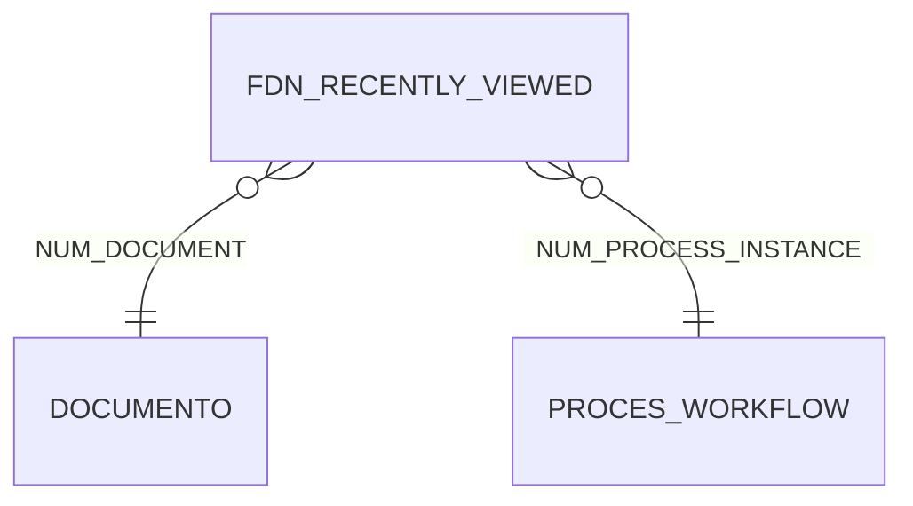

## assinatura-digital

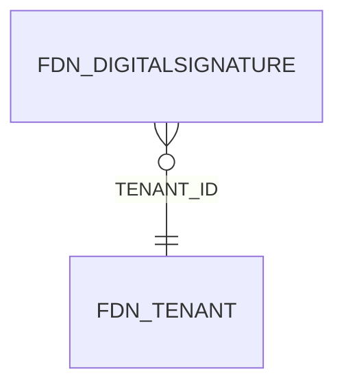

## audit

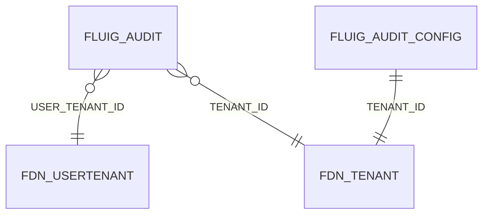

## bpm-analytics-dw

```mermaid
erDiagram
  ACTIVITY_DIM_CAP }o--|| PROCES_VERSION_DIM_CAP : "COMPANYID,PROCESSID,PROCESSVERSION"
  FACT_ACTIVITY_COST_CAP }o--|| ACTIVITY_DIM_CAP : "ACTIVITYID,COMPANYID,PROCESSID,PROCESSVE"
  FACT_ACTIVITY_COST_CAP ||--|| FACT_PROCES_COST_CAP : "COMPANYID,DAYID,MONTHID,PROCESSID,PROCES"
  FACT_ACTIVITY_COST_CAP ||--|| FACT_PROCES_VOLUME_CAP : "COMPANYID,DAYID,MONTHID,PROCESSID,PROCES"
  FACT_ACTIVITY_COST_CAP }o--|| TIME_DIM_CAP : "COMPANYID,DAYID,MONTHID,YEARID"
  FACT_ACTIVITY_COST_CAP }o--|| USER_DIM_CAP : "COMPANYID,USERSEQUENCE"
  FACT_ACTIVITY_COST_CAP }o--|| FDN_USERTENANT : "USERCODE"
  FACT_ACTIVITY_VOLUME_CAP }o--|| ACTIVITY_DIM_CAP : "ACTIVITYID,COMPANYID,PROCESSID,PROCESSVE"
  FACT_ACTIVITY_VOLUME_CAP ||--|| FACT_PROCES_COST_CAP : "COMPANYID,DAYID,MONTHID,PROCESSID,PROCES"
  FACT_ACTIVITY_VOLUME_CAP ||--|| FACT_PROCES_VOLUME_CAP : "COMPANYID,DAYID,MONTHID,PROCESSID,PROCES"
  FACT_ACTIVITY_VOLUME_CAP }o--|| TIME_DIM_CAP : "COMPANYID,DAYID,MONTHID,YEARID"
  FACT_ACTIVITY_VOLUME_CAP }o--|| USER_DIM_CAP : "COMPANYID,USERSEQUENCE"
  FACT_ACTIVITY_VOLUME_CAP }o--|| FDN_USERTENANT : "USERCODE"
  FACT_FLOW_VOLUME_CAP ||--|| FACT_PROCES_COST_CAP : "COMPANYID,DAYID,MONTHID,PROCESSID,PROCES"
  FACT_FLOW_VOLUME_CAP ||--|| FACT_PROCES_VOLUME_CAP : "COMPANYID,DAYID,MONTHID,PROCESSID,PROCES"
  FACT_FLOW_VOLUME_CAP }o--|| FLOW_DIM_CAP : "COMPANYID,PROCESSID,PROCESSVERSION,SOURC"
  FACT_FLOW_VOLUME_CAP }o--|| TIME_DIM_CAP : "COMPANYID,DAYID,MONTHID,YEARID"
  FACT_FLOW_VOLUME_CAP }o--|| USER_DIM_CAP : "COMPANYID,USERSEQUENCE"
  FACT_FLOW_VOLUME_CAP }o--|| PROCES_VERSION_DIM_CAP : "COMPANYID,PROCESSID,PROCESSVERSION"
  FACT_FLOW_VOLUME_CAP }o--|| FDN_USERTENANT : "USERCODE"
  FACT_PROCES_COST_CAP }o--|| PROCES_VERSION_DIM_CAP : "COMPANYID,PROCESSID,PROCESSVERSION"
  FACT_PROCES_COST_CAP }o--|| TIME_DIM_CAP : "COMPANYID,DAYID,MONTHID,YEARID"
  FACT_PROCES_COST_CAP }o--|| USER_DIM_CAP : "COMPANYID,USERSEQUENCE"
  FACT_PROCES_COST_CAP }o--|| FDN_USERTENANT : "USERCODE"
  FACT_PROCES_VOLUME_CAP }o--|| PROCES_VERSION_DIM_CAP : "COMPANYID,PROCESSID,PROCESSVERSION"
  FACT_PROCES_VOLUME_CAP }o--|| TIME_DIM_CAP : "COMPANYID,DAYID,MONTHID,YEARID"
  FACT_PROCES_VOLUME_CAP }o--|| USER_DIM_CAP : "COMPANYID,USERSEQUENCE"
  FACT_PROCES_VOLUME_CAP }o--|| FDN_USERTENANT : "USERCODE"
  FLOW_DIM_CAP }o--|| PROCES_VERSION_DIM_CAP : "COMPANYID,PROCESSID,PROCESSVERSION"
  USER_DIM_CAP }o--|| FDN_USERTENANT : "USERCODE"
```

## bpm-cap

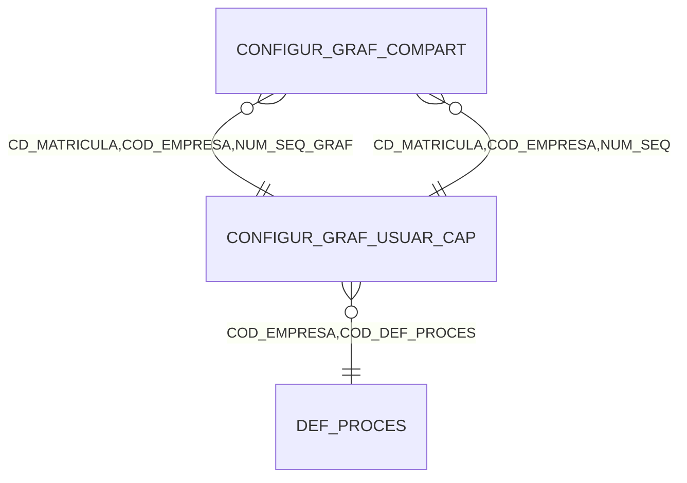

## bpm-definicao-processo

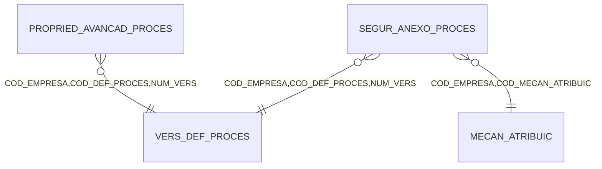

## bpm-forms

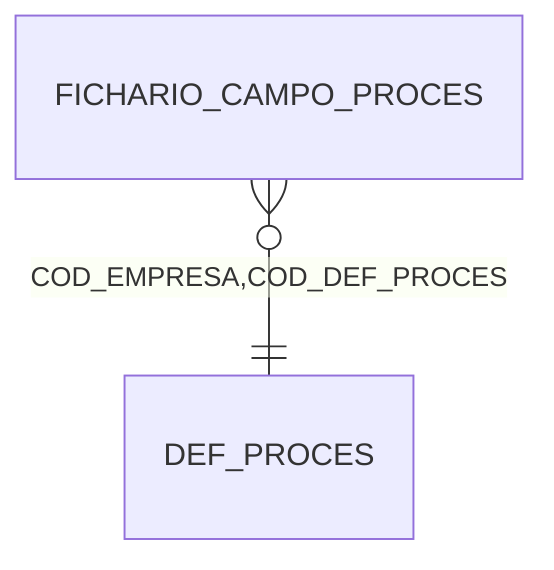

## bpm-integracao

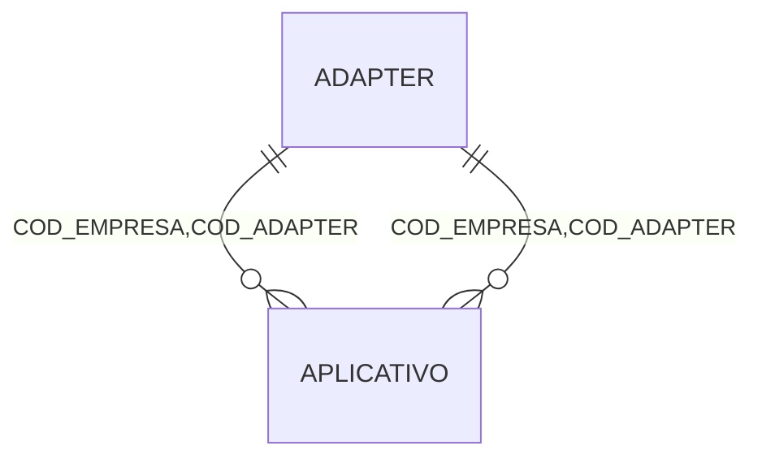

## bpm-process-definition

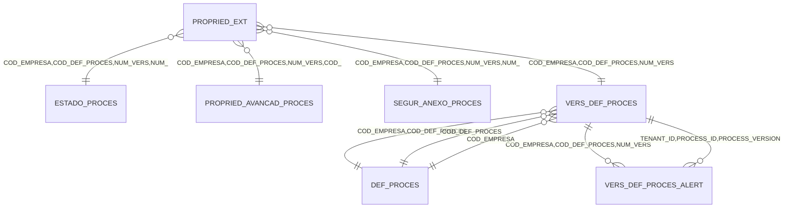

## bpm-tarefas

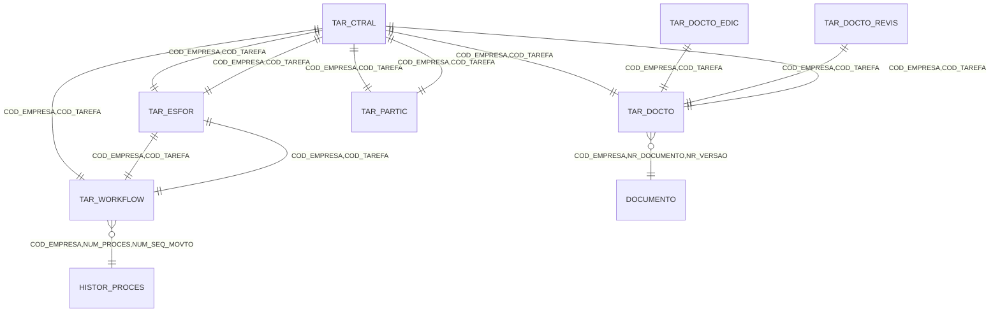

## bpm-workflow

```mermaid
erDiagram
  ADHOC_PROCES }o--|| PROCES_WORKFLOW : "COD_EMPRESA,NUM_PROCES"
  ADHOC_PROCES_WORKFLOW }o--|| PROCES_WORKFLOW : "COD_EMPRESA,NUM_PROCES"
  ADHOC_PROCES_WORKFLOW }o--|| PROCES_WORKFLOW : "COD_EMPRESA,NUM_PROCES_PAI"
  ANEXO_PROCES }o--|| PROCES_WORKFLOW : "COD_EMPRESA,NUM_PROCES"
  ANEXO_PROCES }o--|| DOCUMENTO : "COD_EMPRESA,NR_DOCUMENTO,NR_VERSAO"
  APONT_TAR_PROCES }o--|| TAR_PROCES : "COD_EMPRESA,NUM_PROCES,NUM_SEQ_MOVTO,NUM"
  COLAB_SUBSTTO ||--o{ COLAB_SUBSTTO_PROCESSO : "COLLEAGUE_REPLACEMENT_ID"
  COLAB_SUBSTTO }o--|| FDN_USERTENANT : "COD_EMPRESA,COD_SUBSTTO"
  COLAB_SUBSTTO_PROCESSO }o--|| COLAB_SUBSTTO : "COLLEAGUE_REPLACEMENT_ID"
  COLAB_SUBSTTO_PROCESSO }o--|| DEF_PROCES : "COD_EMPRESA,COD_PROCESS"
  COMPON_GRAF_PROCES }o--|| VERS_DEF_PROCES : "COD_EMPRESA,COD_DEF_PROCES,NUM_VERS"
  DEF_PROCES ||--o{ VERS_DEF_PROCES : "COD_EMPRESA,COD_DEF_PROCES"
  DEF_PROCES ||--o{ DOC_PROCES : "COD_EMPRESA,COD_DEF_PROCES"
  DIAGNOSIS_PROCESS_LOG }o--|| DEF_PROCES : "TENANT_ID,PROCESS_ID"
  DIAGNOSIS_PROCESS_LOG }o--|| PROCES_WORKFLOW : "TENANT_ID,INSTANCE_ID"
  DIAGNOSIS_PROCESS_LOG }o--|| FDN_USER : "USER_ID"
  DOC_PROCES }o--|| VERS_DEF_PROCES : "COD_EMPRESA,COD_DEF_PROCES,NUM_VERS"
  ESTADO_PROCES ||--o{ ESTADO_PROCES_TRIGGER : "COD_EMPRESA,COD_DEF_PROCES,NUM_VERS,NUM_"
  ESTADO_PROCES }o--|| MECAN_ATRIBUIC : "COD_EMPRESA,COD_MECAN_ATRIBUIC"
  ESTADO_PROCES }o--|| PROCES_SIGNAL : "COD_EMPRESA,COD_SINAL"
  ESTADO_PROCES }o--|| VERS_DEF_PROCES : "COD_EMPRESA,COD_DEF_PROCES,NUM_VERS"
  ESTADO_PROCES }o--|| ESTADO_PROCES_TRIGGER : "NUM_VERS"
  ESTADO_PROCES }o--|| ESTADO_PROCES_TRIGGER : "COD_DEF_PROCES"
  ESTADO_PROCES }o--|| ESTADO_PROCES_TRIGGER : "COD_EMPRESA"
  ESTADO_PROCES }o--|| ESTADO_PROCES_TRIGGER : "NUM_SEQ"
  ESTADO_PROCES_COND }o--|| ESTADO_PROCES : "COD_EMPRESA,COD_DEF_PROCES,NUM_VERS,NUM_"
  ESTADO_PROCES_COND }o--|| ESTADO_PROCES : "COD_EMPRESA,COD_DEF_PROCES,NUM_VERS,NUM_"
  ESTADO_PROCES_COND }o--|| MECAN_ATRIBUIC : "COD_EMPRESA,COD_MECAN_ATRIBUIC"
  ESTADO_PROCES_SCRIPT }o--|| ESTADO_PROCES : "COD_EMPRESA,COD_DEF_PROCES,NUM_VERS,NUM_"
  ESTADO_PROCES_SERVICE }o--|| ESTADO_PROCES : "COD_EMPRESA,COD_DEF_PROCES,NUM_VERS,NUM_"
  ESTADO_PROCES_SIGNAL }o--|| ESTADO_PROCES : "COD_EMPRESA,COD_DEF_PROCES,NUM_VERS,NUM_"
  ESTADO_PROCES_SIGNAL }o--|| PROCES_SIGNAL : "COD_EMPRESA,COD_SINAL"
  ESTADO_PROCES_TRIGGER }o--|| ESTADO_PROCES : "COD_EMPRESA,COD_DEF_PROCES,NUM_VERS,NUM_"
  EVENT_FICHA }o--|| DOCUMENTO : "COD_EMPRESA,NR_DOCUMENTO,NR_VERSAO"
  EVENT_FICHA }o--|| EVENT_GERAL : "COD_EMPRESA,COD_EVENT"
  EVENT_PROCES }o--|| VERS_DEF_PROCES : "COD_EMPRESA,COD_DEF_PROCES,NUM_VERS"
  FORM_DATASET }o--|| SERV_DATASET : "COD_EMPRESA,COD_DATASET"
  FORM_DATASET }o--|| DOCUMENTO : "COD_EMPRESA,NR_DOCUMENTO,NR_VERSAO"
  HISTOR_ACES }o--|| DOCUMENTO : "COD_EMPRESA,NR_DOCUMENTO"
  HISTOR_CONVER }o--|| VERS_DEF_PROCES : "COD_EMPRESA,COD_DEF_PROCES,NUM_VERS"
  HISTOR_CONVER ||--o{ HISTOR_CONVER_ESTADO : "COD_EMPRESA,NUM_SEQ_CONVER"
  HISTOR_CONVER_ESTADO }o--|| HISTOR_CONVER : "COD_EMPRESA,NUM_SEQ_CONVER"
  HISTOR_PROCES }o--|| THREAD_PROCES : "COD_EMPRESA,NUM_PROCES,NUM_SEQ_THREAD"
  HISTOR_PROCES }o--|| HISTOR_CONVER_ESTADO : "COD_EMPRESA,NUM_SEQ_CONVER,NUM_SEQ_ESTAD"
  HISTOR_PROCES }o--|| PROCES_WORKFLOW : "COD_EMPRESA,NUM_PROCES"
  HISTOR_PROCES }o--|| HISTOR_PROCES : "COD_EMPRESA,NUM_PROCES,NUM_SEQ_MOVTO_ANT"
  HISTOR_TRANSF_PENDCIA }o--|| TAR_PROCES : "COD_EMPRESA,NUM_PROCES,NUM_SEQ_MOVTO,NUM"
  LINK_PROCES }o--|| VERS_DEF_PROCES : "COD_EMPRESA,COD_DEF_PROCES,NUM_VERS"
  LINK_PROCES }o--|| ESTADO_PROCES : "COD_EMPRESA,COD_DEF_PROCES,NUM_VERS,NUM_"
  LINK_PROCES }o--|| ESTADO_PROCES : "COD_EMPRESA,COD_DEF_PROCES,NUM_VERS,NUM_"
  LINK_PROCES_ASSOC }o--|| COMPON_GRAF_PROCES : "COD_EMPRESA,COD_DEF_PROCES,NUM_VERS,NUM_"
  LINK_PROCES_BEND }o--|| LINK_PROCES : "COD_EMPRESA,COD_DEF_PROCES,NUM_VERS,NUM_"
  LIN_PROCES }o--|| VERS_DEF_PROCES : "COD_EMPRESA,COD_DEF_PROCES,NUM_VERS"
  PARAM_APLICAT }o--|| APLICATIVO : "COD_EMPRESA,COD_APLICAT"
  PARAM_APLICAT_USUAR }o--|| PARAM_APLICAT : "COD_EMPRESA,COD_APLICAT,NOM_PARAM"
  PROCESS_APP_CONFIG }o--|| ESTADO_PROCES : "TENANT_ID,PROCESS_ID,PROCESS_VERSION,STA"
  PROCESS_APP_VALUE }o--|| PROCES_WORKFLOW : "TENANT_ID,INSTANCE_ID"
  PROCESS_ATTACHMENT_RULES }o--|| ESTADO_PROCES : "TENANT_ID,PROCESS_ID,PROCESS_VERSION,STA"
  PROCESS_COND_AUTOMATIC_RULES }o--|| ESTADO_PROCES : "TENANT_ID,PROCESS_ID,PROCESS_VERSION,STA"
  PROCESS_CUSTOM_TRANSLATE }o--|| VERS_DEF_PROCES : "TENANT_ID,PROCESS_ID,VERSION"
  PROCESS_DEFINITION_TRANSLATE }o--|| DEF_PROCES : "TENANT_ID,PROCESS_ID"
  PROCESS_ELEMENT_TRANSLATE }o--|| ESTADO_PROCES : "TENANT_ID,PROCESS_ID,VERSION,SEQUENCE"
  PROCESS_FORM_MAP }o--|| ESTADO_PROCES : "TENANT_ID,PROCESS_CODE,VERSION,STATE_SEQ"
  PROCESS_INSTANCE_MANAGER }o--|| PROCES_WORKFLOW : "TENANT_ID,INSTANCE_ID"
  PROCESS_OBSERVATION }o--|| PROCES_WORKFLOW : "TENANT_ID,NUM_PROCESS"
  PROCESS_VERSION_TRANSLATE }o--|| VERS_DEF_PROCES : "TENANT_ID,PROCESS_ID,VERSION"
  PROCES_SIGNAL_INSTANCE }o--|| PROCES_SIGNAL : "COD_EMPRESA,COD_SINAL"
  PROCES_SIGNAL_INSTANCE }o--|| ESTADO_PROCES : "COD_EMPRESA,COD_DEF_PROCES,NUM_VERS,NUM_"
  PROCES_SIGNAL_INSTANCE }o--|| PROCES_WORKFLOW : "COD_EMPRESA,NUM_PROCES"
  PROCES_SIGNAL_RECEIVERS }o--|| PROCES_SIGNAL : "COD_EMPRESA,COD_SINAL"
  PROCES_SIGNAL_RECEIVERS }o--|| ESTADO_PROCES : "COD_EMPRESA,COD_DEF_PROCES,NUM_VERS,NUM_"
  PROCES_SIGNAL_RECEIVERS }o--|| THREAD_PROCES : "COD_EMPRESA,NUM_PROCES,NUM_SEQ_THREAD"
  PROCES_WORKFLOW }o--|| VERS_DEF_PROCES : "COD_EMPRESA,COD_DEF_PROCES,NUM_VERS"
  PROCES_WORKFLOW }o--|| PROCES_WORKFLOW : "COD_EMPRESA,NUM_PROCES_ORIG"
  TAR_CONHECIMENTO_USUARIO ||--|| TAR_PROCES : "COD_EMPRESA,NUM_PROCES,NUM_SEQ_MOVTO,NUM"
  TAR_CONHECIMENTO_USUARIO }o--|| HISTOR_PROCES : "COD_EMPRESA,NUM_PROCES,NUM_SEQ_MOVTO"
  TAR_PROCES }o--|| PROCES_WORKFLOW : "COD_EMPRESA,NUM_PROCES"
  TAR_PROCES }o--|| HISTOR_PROCES : "COD_EMPRESA,NUM_PROCES,NUM_SEQ_MOVTO"
  TAR_PROCES }o--|| FDN_USERTENANT : "CD_MATRICULA"
  TAR_PROCES }o--|| PROCES_WORKFLOW : "COD_EMPRESA"
  TAR_PROCES }o--|| PROCES_WORKFLOW : "NUM_PROCES"
  THREAD_PROCES }o--|| PROCES_WORKFLOW : "COD_EMPRESA,NUM_PROCES"
  VAL_HORA_COLAB }o--|| FDN_USERTENANT : "CD_MATRICULA"
  VERBOSE_SCRIPT_LOG }o--|| FDN_USERTENANT : "USER_ID"
  VERBOSE_SCRIPT_LOG }o--|| PROCES_WORKFLOW : "TENANT_ID,IDENTIFIER"
```

## bpm-workflow-erro

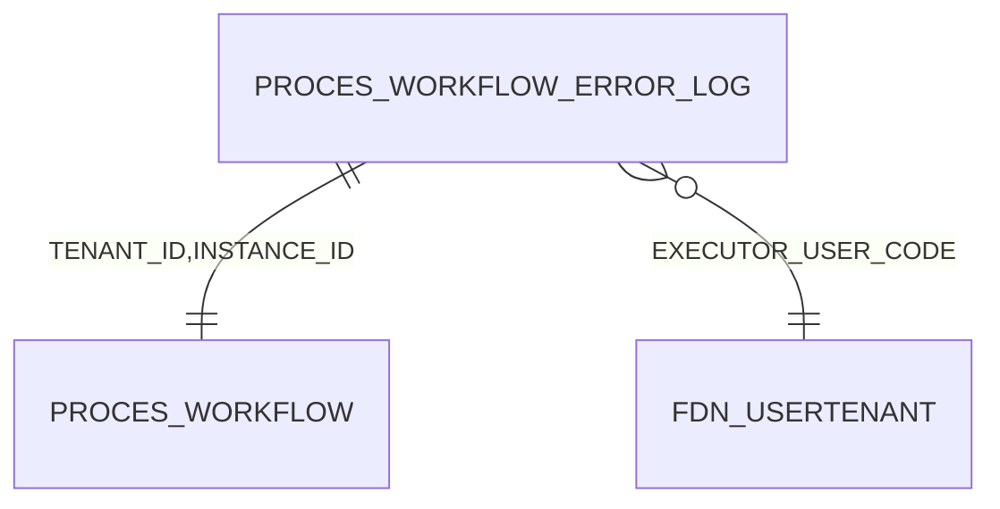

## calendario-feriados

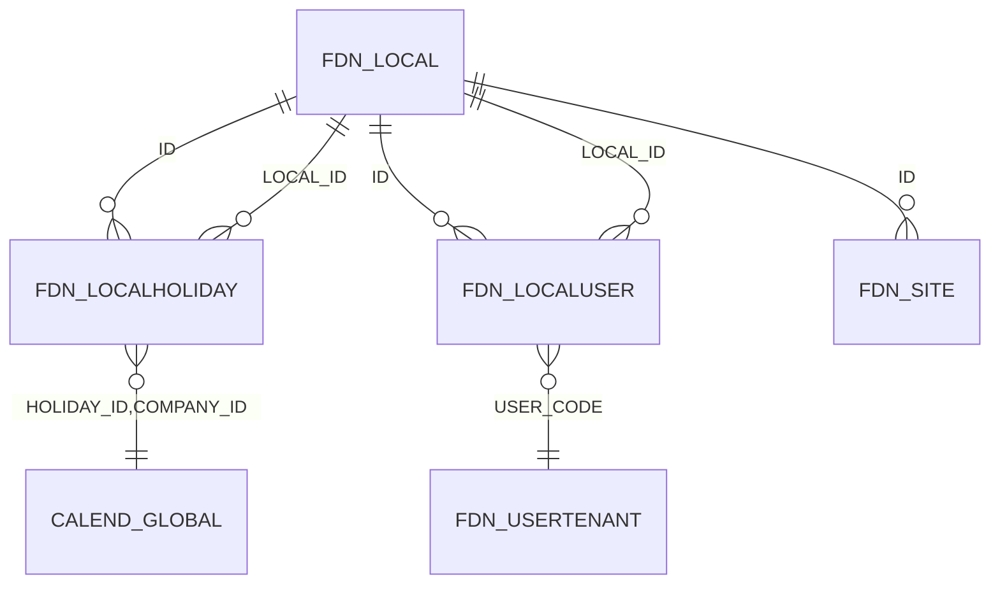

## configuracao-parametros

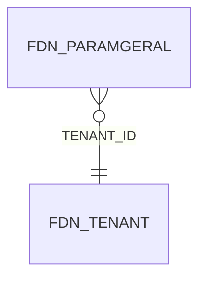

## datasets

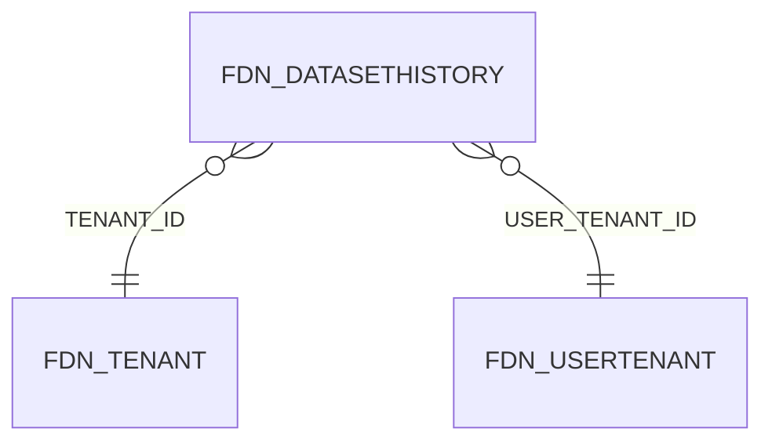

## ecm-collaboration

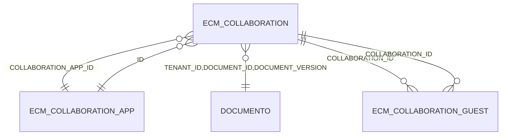

## ecm-documentos

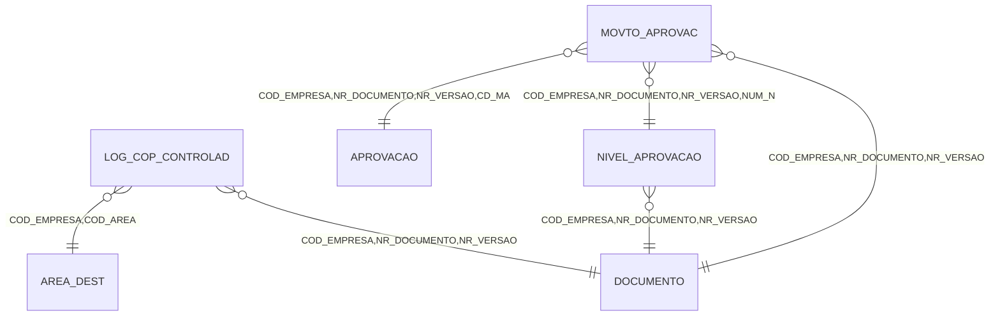

## ecm-documents

```mermaid
erDiagram
  ASSUNTO ||--o{ ASSUNTO_FAVORITO : "COD_EMPRESA,CD_ASSUNTO"
  ASSUNTO ||--o{ CONFIGUR_OBRIG_ASSUNTO : "COD_EMPRESA,CD_ASSUNTO"
  ASSUNTO_FAVORITO }o--|| ASSUNTO : "COD_EMPRESA,CD_ASSUNTO"
  CAMPO_CUSTOM ||--o{ DOCTO_CAMPO_CUSTOM : "COD_EMPRESA,COD_CAMPO_CUSTOM"
  CONFIGUR_OBRIG_ASSUNTO }o--|| ASSUNTO : "COD_EMPRESA,CD_ASSUNTO"
  CONFIGUR_SEGUR_DOCTO }o--|| DOCUMENTO : "COD_EMPRESA,NR_DOCUMENTO,NR_VERSAO"
  CONHECIMENTO }o--|| DOCUMENTO : "COD_EMPRESA,NR_DOCUMENTO,NR_VERSAO"
  DEFAULT_PROPRIED_DOCTO }o--|| DOCUMENTO : "COD_EMPRESA,NR_DOCUMENTO,NR_VERSAO"
  DOCTO_ALOCAD }o--|| DOCUMENTO : "COD_EMPRESA,NUM_DOCTO_ORIG,NUM_VERS_ORIG"
  DOCTO_ALOCAD }o--|| DOCUMENTO : "COD_EMPRESA,NUM_DOCTO_DEST"
  DOCTO_ANOTACAO_COLAB }o--|| DOCUMENTO : "COD_EMPRESA,NR_DOCUMENTO,NR_VERSAO"
  DOCTO_ANOTACAO_COLAB }o--|| DOCTO_ANOTACAO_COLAB : "NR_ANOTACAO_PAI"
  DOCTO_APLICAT }o--|| APLICATIVO : "COD_EMPRESA,COD_APLICAT"
  DOCTO_APLICAT }o--|| DOCUMENTO : "COD_EMPRESA,NR_DOCUMENTO,NR_VERSAO"
  DOCTO_CAMPO_CUSTOM }o--|| CAMPO_CUSTOM : "COD_EMPRESA,COD_CAMPO_CUSTOM"
  DOCTO_CAMPO_CUSTOM }o--|| DOCUMENTO : "COD_EMPRESA,NR_DOCUMENTO,NR_VERSAO"
  DOCTO_COMENT }o--|| DOCUMENTO : "COD_EMPRESA,NR_DOCUMENTO,NR_VERSAO"
  DOCTO_CONTDO }o--|| DOCUMENTO : "COD_EMPRESA,NR_DOCUMENTO,NR_VERSAO"
  DOCTO_DESTAQ_COLAB }o--|| DOCUMENTO : "COD_EMPRESA,NR_DOCUMENTO,NR_VERSAO"
  DOCTO_NOTIF }o--|| DOCUMENTO : "COD_EMPRESA,NR_DOCUMENTO"
  DOCTO_OBS_COLAB }o--|| DOCUMENTO : "COD_EMPRESA,NR_DOCUMENTO,NR_VERSAO"
  DOCTO_RANKING }o--|| DOCUMENTO : "COD_EMPRESA,NR_DOCUMENTO,NR_VERSAO"
  DOCTO_RELACDO }o--|| DOCUMENTO : "COD_EMPRESA,NR_DOCUMENTO,NR_VERSAO"
  DOCTO_RELACDO }o--|| DOCUMENTO : "COD_EMPRESA,NUM_DOCTO_RELACDO"
  DOCTO_SOCIAL }o--|| DOCUMENTO : "COD_EMPRESA,NR_DOCUMENTO"
  DOCTO_TAG }o--|| DOCUMENTO : "COD_EMPRESA,NR_DOCUMENTO,NR_VERSAO"
  DOCTO_TAG }o--|| TAG : "COD_EMPRESA,COD_TAG"
  DOCUMENTO ||--o{ LINK_DOCTO_VIRTUAL : "NR_DOCUMENTO"
  DOCUMENTO }o--|| DOCUMENTO : "COD_EMPRESA,NR_DOCUMENTO_PAI"
  DOCUMENTO }o--|| TIPO_DOCUMENTO : "COD_EMPRESA,CD_TIPO_DOC"
  DOCUMENTO }o--|| MARCA_DAGUA : "COD_EMPRESA,NR_MARCA_DAGUA"
  DOCUMENTO }o--|| ICONE : "COD_EMPRESA,NR_ICONE"
  DOCUMENTO }o--|| META_LISTA : "COD_EMPRESA,COD_LISTA"
  DOCUMENTO ||--o{ DOCTO_DESTAQ_COLAB : "COD_EMPRESA,NR_DOCUMENTO,NR_VERSAO,CD_MA"
  DOCUMENTO ||--o{ DOCTO_RANKING : "COD_EMPRESA,NR_DOCUMENTO,NR_VERSAO,CD_MA"
  DOCUMENTO ||--o{ PREFER_PASTA : "COD_EMPRESA,NR_DOCUMENTO,NR_VERSAO,CD_MA"
  DOCUMENTO }o--|| FDN_USERTENANT : "CD_MATRICULA"
  LINK_DOCTO_VIRTUAL }o--|| DOCUMENTO : "NR_DOCUMENTO"
  LINK_DOCTO_VIRTUAL }o--|| DOCUMENTO : "COD_EMPRESA,NR_DOCTO_PAI_CORREN"
  MARCA_DAGUA ||--o{ DOCUMENTO : "COD_EMPRESA,NR_MARCA_DAGUA"
  TIPO_DOCUMENTO ||--o{ DOCUMENTO : "COD_EMPRESA,CD_TIPO_DOC"
```

## ecm-forms

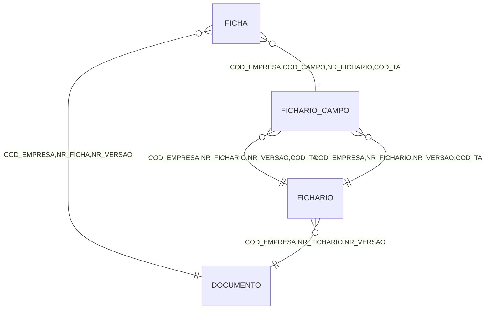

## ecm-lists-filters

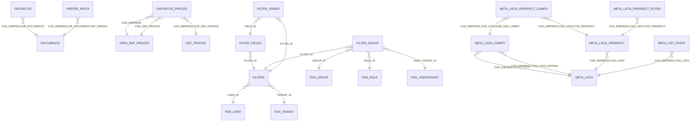

## ecm-metadata-forms

```mermaid
erDiagram
  ECM_ABSTRACT_FORM_ITEM }o--|| ECM_METADATA_FORM : "METADATAFORM_ID"
  ECM_ABSTRACT_FORM_ITEM }o--|| ECM_ABSTRACT_FORM_ITEM : "PARENT_ITEM"
  ECM_BUTTON_FORM_ITEM }o--|| ECM_METADATA_FORM : "METADATAFORM_ID"
  ECM_BUTTON_FORM_ITEM ||--|| ECM_ABSTRACT_FORM_ITEM : "METADATAFORM_ID,HTML_ID"
  ECM_DATE_FIELD_FORM_ITEM }o--|| ECM_METADATA_FORM : "METADATAFORM_ID"
  ECM_DATE_FIELD_FORM_ITEM ||--|| ECM_ABSTRACT_FORM_ITEM : "METADATAFORM_ID,HTML_ID"
  ECM_DIVIDER_FORM_ITEM }o--|| ECM_METADATA_FORM : "METADATAFORM_ID"
  ECM_DIVIDER_FORM_ITEM ||--|| ECM_ABSTRACT_FORM_ITEM : "METADATAFORM_ID,HTML_ID"
  ECM_DOCTO_LANGUAGE }o--|| FDN_TENANT : "TENANT_ID"
  ECM_DYNAMIC_TABLE_FORM_ITEM }o--|| ECM_METADATA_FORM : "METADATAFORM_ID"
  ECM_DYNAMIC_TABLE_FORM_ITEM ||--|| ECM_ABSTRACT_FORM_ITEM : "METADATAFORM_ID,HTML_ID"
  ECM_EVALUATION_FIELD_FORM_ITEM }o--|| ECM_METADATA_FORM : "METADATAFORM_ID"
  ECM_EVALUATION_FIELD_FORM_ITEM ||--|| ECM_ABSTRACT_FORM_ITEM : "METADATAFORM_ID,HTML_ID"
  ECM_EXTERNAL_LINK_FORM_ITEM }o--|| ECM_METADATA_FORM : "METADATAFORM_ID"
  ECM_EXTERNAL_LINK_FORM_ITEM ||--|| ECM_ABSTRACT_FORM_ITEM : "METADATAFORM_ID,HTML_ID"
  ECM_FIXED_TABLE_COLUMN }o--|| ECM_FIXED_TABLE_FORM_ITEM : "METADATAFORM_ID,HTML_ID_FIXEDTABLE_ITEM"
  ECM_FIXED_TABLE_FORM_ITEM }o--|| ECM_METADATA_FORM : "METADATAFORM_ID"
  ECM_FIXED_TABLE_FORM_ITEM ||--|| ECM_ABSTRACT_FORM_ITEM : "METADATAFORM_ID,HTML_ID"
  ECM_FIXED_TABLE_FORM_ITEM ||--o{ ECM_FIXED_TABLE_ROW : "METADATAFORM_ID,HTML_ID"
  ECM_FIXED_TABLE_FORM_ITEM ||--o{ ECM_FIXED_TABLE_COLUMN : "METADATAFORM_ID,HTML_ID"
  ECM_FIXED_TABLE_ROW }o--|| ECM_FIXED_TABLE_FORM_ITEM : "METADATAFORM_ID,HTML_ID_FIXEDTABLE_ITEM"
  ECM_FIXED_TABLE_ROW }o--|| ECM_FIXED_TABLE_COLUMN : "METADATAFORM_ID,COLUMN_HTML_ID"
  ECM_IMAGE_FORM_ITEM }o--|| ECM_METADATA_FORM : "METADATAFORM_ID"
  ECM_IMAGE_FORM_ITEM ||--|| ECM_ABSTRACT_FORM_ITEM : "METADATAFORM_ID,HTML_ID"
  ECM_IMAGE_FORM_ITEM }o--|| DOCUMENTO : "DOCUMENT_ID,DOCUMENT_VERSION"
  ECM_LABEL_FORM_ITEM }o--|| ECM_METADATA_FORM : "METADATAFORM_ID"
  ECM_LABEL_FORM_ITEM ||--|| ECM_ABSTRACT_FORM_ITEM : "METADATAFORM_ID,HTML_ID"
  ECM_LIST_FIELD_FORM_ITEM }o--|| ECM_METADATA_FORM : "METADATAFORM_ID"
  ECM_LIST_FIELD_FORM_ITEM ||--|| ECM_ABSTRACT_FORM_ITEM : "METADATAFORM_ID,HTML_ID"
  ECM_METADATA_FORM }o--|| DOCUMENTO : "TENANT_ID,DOCUMENT_ID,DCMNT_VRSN_NMBER"
  ECM_METADATA_FORM ||--o{ ECM_METADATA_FORM_TRANSLATE : "ID"
  ECM_METADATA_FORM ||--o{ ECM_ABSTRACT_FORM_ITEM : "ID"
  ECM_METADATA_FORM_TRANSLATE }o--|| ECM_METADATA_FORM : "METADATAFORM_ID"
  ECM_NUMBER_FIELD_FORM_ITEM }o--|| ECM_METADATA_FORM : "METADATAFORM_ID"
  ECM_NUMBER_FIELD_FORM_ITEM ||--|| ECM_ABSTRACT_FORM_ITEM : "METADATAFORM_ID,HTML_ID"
  ECM_SECTION_FORM_ITEM }o--|| ECM_METADATA_FORM : "METADATAFORM_ID"
  ECM_SECTION_FORM_ITEM ||--|| ECM_ABSTRACT_FORM_ITEM : "METADATAFORM_ID,HTML_ID"
  ECM_TAB_FORM_ITEM }o--|| ECM_METADATA_FORM : "METADATAFORM_ID"
  ECM_TAB_FORM_ITEM ||--|| ECM_ABSTRACT_FORM_ITEM : "METADATAFORM_ID,HTML_ID"
  ECM_TAB_FORM_ITEM ||--o{ ECM_TAB_ITEM : "METADATAFORM_ID,HTML_ID"
  ECM_TAB_ITEM }o--|| ECM_TAB_FORM_ITEM : "METADATAFORM_ID,HTML_ID_TABFORM_ITEM"
  ECM_TEXT_AREA_FIELD_FORM_ITEM }o--|| ECM_METADATA_FORM : "METADATAFORM_ID"
  ECM_TEXT_AREA_FIELD_FORM_ITEM ||--|| ECM_ABSTRACT_FORM_ITEM : "METADATAFORM_ID,HTML_ID"
  ECM_TEXT_FIELD_FORM_ITEM }o--|| ECM_METADATA_FORM : "METADATAFORM_ID"
  ECM_TEXT_FIELD_FORM_ITEM ||--|| ECM_ABSTRACT_FORM_ITEM : "METADATAFORM_ID,HTML_ID"
  ECM_TITLE_FORM_ITEM }o--|| ECM_METADATA_FORM : "METADATAFORM_ID"
  ECM_TITLE_FORM_ITEM ||--|| ECM_ABSTRACT_FORM_ITEM : "METADATAFORM_ID,HTML_ID"
  ECM_UPLOAD_FILE_FORM_ITEM }o--|| ECM_METADATA_FORM : "METADATAFORM_ID"
  ECM_UPLOAD_FILE_FORM_ITEM ||--|| ECM_ABSTRACT_FORM_ITEM : "METADATAFORM_ID,HTML_ID"
  ECM_ZOOM_DISPLAY_FIELD }o--|| ECM_ZOOM_FIELD_FORM_ITEM : "METADATAFORM_ID,HTML_ID_ZOOM_ITEM"
  ECM_ZOOM_FIELD_FORM_ITEM }o--|| ECM_METADATA_FORM : "METADATAFORM_ID"
  ECM_ZOOM_FIELD_FORM_ITEM ||--|| ECM_ABSTRACT_FORM_ITEM : "METADATAFORM_ID,HTML_ID"
  ECM_ZOOM_FIELD_FORM_ITEM ||--o{ ECM_ZOOM_DISPLAY_FIELD : "METADATAFORM_ID,HTML_ID"
  ECM_ZOOM_FIELD_FORM_ITEM ||--o{ ECM_ZOOM_FILTER_FIELD : "METADATAFORM_ID,HTML_ID"
  ECM_ZOOM_FIELD_FORM_ITEM ||--o{ ECM_ZOOM_OUTPUT_FIELD : "METADATAFORM_ID,HTML_ID"
  ECM_ZOOM_FILTER_FIELD }o--|| ECM_ZOOM_FIELD_FORM_ITEM : "METADATAFORM_ID,HTML_ID_ZOOM_ITEM"
  ECM_ZOOM_OUTPUT_FIELD }o--|| ECM_ZOOM_FIELD_FORM_ITEM : "METADATAFORM_ID,HTML_ID_ZOOM_ITEM"
  ECM_ZOOM_OUTPUT_FIELD }o--|| ECM_ABSTRACT_FORM_ITEM : "METADATAFORM_ID,HTML_ID"
  ECM_ZOOM_USER_FORM_ITEM }o--|| ECM_METADATA_FORM : "METADATAFORM_ID"
  ECM_ZOOM_USER_FORM_ITEM ||--|| ECM_ABSTRACT_FORM_ITEM : "METADATAFORM_ID,HTML_ID"
```

## ecm-search

```mermaid
erDiagram
  SINONIMO }o--|| TERMO : "COD_EMPRESA,IND_IDIOMA,COD_TERMO"
  TERMO ||--o{ SINONIMO : "COD_EMPRESA,IND_IDIOMA,COD_TERMO"
```

## foundation-alert

```mermaid
erDiagram
  FDN_ALERT }o--|| FDN_USERTENANT : "RECEIVER_ID"
  FDN_ALERT }o--|| FDN_ALERTEVENTTYPE : "EVENT_TYPE_ID"
  FDN_ALERT }o--|| FDN_ALERTOBJECT : "OBJECT_ID"
  FDN_ALERT }o--|| FDN_ALERTOBJECT : "PLACE_ID"
  FDN_ALERT ||--o{ FDN_ALERTACTION : "ID"
  FDN_ALERT ||--o{ FDN_ALERTMETADATA : "ID"
  FDN_ALERT ||--o{ FDN_ALERTSENDER : "ID"
  FDN_ALERTACTION }o--|| FDN_ALERT : "ALERT_ID"
  FDN_ALERTAPPSENDER }o--|| FDN_TENANT : "TENANT_ID"
  FDN_ALERTAPPSENDER ||--o{ FDN_ALERTCONFIG : "ID"
  FDN_ALERTCONFIG }o--|| FDN_USERTENANT : "USER_ID"
  FDN_ALERTCONFIG }o--|| FDN_ALERTEVENTTYPE : "EVENT_TYPE_ID"
  FDN_ALERTCONFIG }o--|| FDN_ALERTAPPSENDER : "SENDER_APP_ID"
  FDN_ALERTCONFIG }o--|| FDN_TENANT : "TENANT_ID"
  FDN_ALERTEVENTTYPE }o--|| FDN_ALERTMODULE : "MODULE_ID"
  FDN_ALERTEVENTTYPE }o--|| FDN_TENANT : "TENANT_ID"
  FDN_ALERTMETADATA }o--|| FDN_ALERT : "ALERT_ID"
  FDN_ALERTMODULE }o--|| FDN_TENANT : "TENANT_ID"
  FDN_ALERTMODULE ||--o{ FDN_ALERTEVENTTYPE : "ID"
  FDN_ALERTOBJECT ||--o{ FDN_ALERT : "ID"
  FDN_ALERTOBJECT ||--o{ FDN_ALERT : "ID"
  FDN_ALERTSENDER }o--|| FDN_USERTENANT : "USER_ID"
  FDN_ALERTSENDER }o--|| FDN_ALERT : "ALERT_ID"
```

## foundation-dataservice

```mermaid
erDiagram
  FDN_SERVICE_OPERATION }o--|| FDN_TENANT : "TENANT_ID"
```

## foundation-identity-access

```mermaid
erDiagram
  FDN_GROUP }o--|| FDN_TENANT : "TENANT_ID"
  FDN_GROUPDATA }o--|| FDN_GROUP : "GROUP_ID"
  FDN_GROUPUSERROLE }o--|| FDN_USERTENANT : "LOGIN"
  FDN_GROUPUSERROLE }o--|| FDN_ROLE : "TENANT_ID,ROLE_CODE"
  FDN_GROUPUSERROLE }o--|| FDN_GROUP : "TENANT_ID,CHILD_GROUPCODE"
  FDN_GROUPUSERROLE }o--|| FDN_GROUP : "TENANT_ID,GROUP_CODE"
  FDN_GROUPUSERROLE }o--|| FDN_TENANT : "TENANT_ID"
  FDN_IDENTITYPARTNER }o--|| FDN_TENANT : "TENANT_ID"
  FDN_PERMISSION }o--|| FDN_RESOURCE : "RESOURCE_ID"
  FDN_PERMISSION }o--|| FDN_USERTENANT : "LOGIN"
  FDN_PERMISSION }o--|| FDN_GROUP : "TENANT_ID,GROUP_CODE"
  FDN_PERMISSION }o--|| FDN_ROLE : "TENANT_ID,ROLE_CODE"
  FDN_PERMISSION_MAPPING }o--|| FDN_RESOURCE : "RESOURCE_CODE"
  FDN_PERMISSION_MAPPING }o--|| FDN_RESOURCE : "TO_RESOURCE_CODE"
  FDN_RESOURCE }o--|| FDN_RESOURCETYPE : "RESOURCE_TYPE_ID"
  FDN_RESOURCE }o--|| FDN_RESOURCE : "PARENT_ID"
  FDN_RESOURCE ||--o{ FDN_PERMISSION : "RESOURCE_ID"
  FDN_RESOURCE ||--o{ FDN_RESTORE_PERMISSION_MAPPING : "RESOURCE_ID"
  FDN_RESOURCETYPE ||--o{ FDN_RESOURCE : "RESOURCE_TYPE_ID"
  FDN_RESOURCETYPE ||--o{ FDN_RESOURCETYPEPERMISSION : "RESOURCE_TYPE_ID"
  FDN_RESOURCETYPEPERMISSION }o--|| FDN_RESOURCETYPE : "RESOURCE_TYPE_ID"
  FDN_RESTORE_PERMISSION_MAPPING }o--|| FDN_RESOURCE : "RESOURCE_ID"
  FDN_ROLE }o--|| FDN_TENANT : "TENANT_ID"
  FDN_ROLE ||--o{ FDN_USERROLE : "TENANT_ID,ROLE_CODE"
  FDN_ROLEDATA }o--|| FDN_ROLE : "ROLE_ID"
  FDN_USER }o--|| FDN_USER : "ANONYMIZATION_USER_ID"
  FDN_USER ||--o{ FDN_USERTENANT : "USER_ID"
  FDN_USERDATA }o--|| FDN_USERTENANT : "USER_TENANT_ID"
  FDN_USERDATA }o--|| FDN_USERTENANT : "ANONYMIZATION_USER_ID"
  FDN_USERLOGGING }o--|| FDN_USERTENANT : "LOGIN"
  FDN_USERLOGGING }o--|| FDN_TENANT : "TENANT_ID"
  FDN_USERPICTURE ||--|| FDN_USERTENANT : "USER_TENANT_ID"
  FDN_USERROLE }o--|| FDN_USERTENANT : "LOGIN"
  FDN_USERROLE }o--|| FDN_ROLE : "TENANT_ID,ROLE_CODE"
  FDN_USERROLE }o--|| FDN_TENANT : "TENANT_ID"
  FDN_USERTENANT }o--|| FDN_USER : "USER_ID"
  FDN_USERTENANT }o--|| FDN_TENANT : "TENANT_ID"
  FDN_USERTENANT }o--|| FDN_USERTENANT : "ANONYMIZATION_USER_ID"
  FDN_USERTENANT ||--o{ FDN_USERDATA : "USER_TENANT_ID"
```

## foundation-platform

```mermaid
erDiagram
  FDN_SITESCHEDULER }o--|| FDN_SITE : "SITE_ID"
  FDN_VOLUME }o--|| FDN_TENANT : "TENANT_ID"
  FDN_VOLUME ||--o{ FDN_VOLUMESITE : "VOLUME_ID"
  FDN_VOLUMESITE }o--|| FDN_VOLUME : "VOLUME_ID"
  FDN_VOLUMESITE }o--|| FDN_SITE : "SITE_ID"
```

## foundation-tenancy

```mermaid
erDiagram
  FDN_PRODUCT ||--o{ FDN_TENANTPRODUCT : "PRODUCT_CODE"
  FDN_TENANT ||--o{ FDN_TENANTDATA : "TENANT_ID"
  FDN_TENANT ||--o{ FDN_TENANTPRODUCT : "TENANT_ID"
  FDN_TENANT ||--o{ FDN_USERTENANT : "TENANT_ID"
  FDN_TENANTDATA }o--|| FDN_TENANT : "TENANT_ID"
  FDN_TENANTPRODUCT }o--|| FDN_TENANT : "TENANT_ID"
  FDN_TENANTPRODUCT }o--|| FDN_PRODUCT : "PRODUCT_CODE"
```

## ged-documentos

```mermaid
erDiagram
  APROVACAO }o--|| DOCUMENTO : "COD_EMPRESA,NR_DOCUMENTO,NR_VERSAO"
  APROVACAO }o--|| NIVEL_APROVACAO : "COD_EMPRESA,NR_DOCUMENTO,NR_VERSAO,NUM_N"
  APROVADOR }o--|| NIVEL_APROVACAO : "COD_EMPRESA,NR_DOCUMENTO,NR_VERSAO,NUM_N"
  APROVADOR ||--|| APROVACAO : "COD_EMPRESA,NR_DOCUMENTO,NR_VERSAO,CD_MA"
```

## i18n

```mermaid
erDiagram
  I18N_BUNDLE ||--o{ I18N_LOCALE : "BUNDLE_ID"
  I18N_BUNDLE ||--o{ I18N_RELATED_BUNDLE : "BUNDLE_ID"
  I18N_LITERAL_TRANSLATED }o--|| I18N_LOCALE : "LOCALE_ID"
  I18N_LOCALE }o--|| I18N_BUNDLE : "BUNDLE_ID"
  I18N_LOCALE ||--o{ I18N_LITERAL_TRANSLATED : "LOCALE_ID"
  I18N_RELATED_BUNDLE }o--|| I18N_BUNDLE : "BUNDLE_ID"
  I18N_RELATED_BUNDLE }o--|| I18N_BUNDLE : "RELATED_BUNDLE_CODE"
```

## infraestrutura-servidor

```mermaid
erDiagram
  FDN_SERVER_INFO }o--|| QRTZ_SCHEDULER_STATE : "INSTANCE_NAME"
```

## integracao-datasets

```mermaid
erDiagram
  SERV_DATASET }o--|| META_LISTA : "COD_EMPRESA,COD_LISTA"
```

## integracao-eventos

```mermaid
erDiagram
  FDN_INTEGRATION ||--o{ FDN_INTEGRATIONEVENT : "INTEGRATION_ID"
  FDN_INTEGRATIONEVENT }o--|| FDN_INTEGRATION : "INTEGRATION_ID"
  FDN_INTEGRATIONLISTENEREVT }o--|| FDN_INTEGRATIONEVENT : "EVENT_NAME"
```

## integracao-servidores

```mermaid
erDiagram
  FDN_FLUIG_SERVER }o--|| FDN_AUTHORIZECLIENTDATA : "AUTHORIZECLIENTDATA_ID"
```

## mail

```mermaid
erDiagram
  MAILEVENTTEMPLATE }o--|| FDN_TENANT : "TENANTID"
```

## mobile-push

```mermaid
erDiagram
  FDN_PUSH }o--|| FDN_OAUTHAPPUSER : "FDN_OAUTH_APPLICATION_USER_ID"
  FDN_PUSH }o--|| FDN_TENANT : "TENANT_ID"
```

## monitoring-metrics

```mermaid
erDiagram
  LS_METRIC }o--|| FDN_TENANT : "TENANT_ID"
  LS_METRIC ||--o{ LS_METRIC_DETAIL : "METRIC_ID"
  LS_METRIC_DETAIL }o--|| LS_METRIC : "METRIC_ID"
```

## oauth-integracao

```mermaid
erDiagram
  FDN_AUTHORIZECLIENTDATA }o--|| FDN_TENANT : "TENANT_ID"
```

## oauth-provider

```mermaid
erDiagram
  FDN_OAUTHAPP }o--|| FDN_OAUTHPROVIDER : "OAUTH_PROVIDER_ID"
  FDN_OAUTHAPPDATA }o--|| FDN_OAUTHAPP : "OAUTH_APP_ID"
  FDN_OAUTHAPPTOKEN }o--|| FDN_OAUTHAPP : "OAUTH_APP_ID"
  FDN_OAUTHAPPUSER }o--|| FDN_OAUTHAPPTOKEN : "OAUTH_APP_TOKEN_ID"
  FDN_OAUTHAPPUSER }o--|| FDN_OAUTHAPP : "OAUTH_APP_ID"
  FDN_OAUTHAPPUSER }o--|| FDN_USERTENANT : "LOGIN"
  FDN_OAUTHPROVIDER }o--|| FDN_TENANT : "TENANT_ID"
```

## permissoes-categorias

```mermaid
erDiagram
  FDN_CATEGORY }o--|| FDN_CATEGORY : "PARENT_CATEGORY_ID"
  FDN_CATEGORY ||--o{ FDN_CATEGORY_RESOURCE : "CATEGORY_ID"
  FDN_CATEGORY_RESOURCE }o--|| FDN_RESOURCE : "RESOURCE_ID"
  FDN_CATEGORY_RESOURCE }o--|| FDN_CATEGORY : "CATEGORY_ID"
```

## privacy-lgpd

```mermaid
erDiagram
  FDN_PDATATRACE }o--|| FDN_USERTENANT : "USER_TENANT_ID"
  FDN_PDATATRACE }o--|| FDN_PERSONALDATA : "RESOURCE_TABLE,FIELDS"
  FDN_PDATATRACE_CONFIG ||--|| FDN_TENANT : "TENANT_ID"
  FDN_PDATA_CLASSIFICATION ||--o{ FDN_PDATA_JUSTIFICATION : "PDATA_CLASSIFICATION_ID"
  FDN_PDATA_INFOTYPE ||--o{ FDN_PERSONALDATA : "INFORMATION_TYPE_ID"
  FDN_PDATA_JUSTIFICATION }o--|| FDN_PERSONALDATA : "PERSONALDATA_ID"
  FDN_PDATA_JUSTIFICATION }o--|| FDN_PDATA_CLASSIFICATION : "PDATA_CLASSIFICATION_ID"
  FDN_PERSONALDATA }o--|| FDN_TENANT : "TENANT_ID"
  FDN_PERSONALDATA }o--|| FDN_PDATA_INFOTYPE : "INFORMATION_TYPE_ID"
  FDN_PERSONALDATA }o--|| FDN_USERTENANT : "USER_TENANT_ID"
  FDN_PERSONALDATA }o--|| FDN_USERTENANT : "REMOVED_BY_USER_TENANT_ID"
  FDN_PERSONALDATA ||--o{ FDN_PDATA_JUSTIFICATION : "PERSONALDATA_ID"
```

## rating

```mermaid
erDiagram
  RATING }o--|| FDN_TENANT : "TENANT_ID"
```

## scheduler-quartz

```mermaid
erDiagram
  QRTZ_BLOB_TRIGGERS ||--|| QRTZ_TRIGGERS : "TRIGGER_GROUP,TRIGGER_NAME"
  QRTZ_CRON_TRIGGERS ||--|| QRTZ_TRIGGERS : "TRIGGER_GROUP,TRIGGER_NAME"
  QRTZ_FIRED_TRIGGERS }o--|| QRTZ_TRIGGERS : "TRIGGER_GROUP,TRIGGER_NAME"
  QRTZ_FIRED_TRIGGERS }o--|| QRTZ_JOB_DETAILS : "JOB_GROUP,JOB_NAME"
  QRTZ_FIRED_TRIGGERS }o--|| QRTZ_SCHEDULER_STATE : "INSTANCE_NAME"
  QRTZ_JOB_LISTENERS }o--|| QRTZ_JOB_DETAILS : "JOB_GROUP,JOB_NAME"
  QRTZ_SIMPLE_TRIGGERS ||--|| QRTZ_TRIGGERS : "TRIGGER_GROUP,TRIGGER_NAME"
  QRTZ_TRIGGERS }o--|| QRTZ_JOB_DETAILS : "JOB_GROUP,JOB_NAME"
  QRTZ_TRIGGERS }o--|| QRTZ_CALENDARS : "CALENDAR_NAME"
  QRTZ_TRIGGER_LISTENERS }o--|| QRTZ_TRIGGERS : "TRIGGER_GROUP,TRIGGER_NAME"
```

## security-oauth-tokens

```mermaid
erDiagram
  RESET_PASSWORD_TOKEN }o--|| FDN_USERTENANT : "USER_TENANT_ID"
  SESSAO_TOKEN }o--|| FDN_USERTENANT : "LOGIN"
```

## seguranca

```mermaid
erDiagram
  FDN_JAASUSERGROUP }o--|| FDN_USERTENANT : "LOGIN"
  FDN_REQUEST_NONCE }o--|| FDN_TENANT : "TENANT_ID"
  FDN_USERTOKEN }o--|| FDN_TENANT : "TENANT_ID"
  FDN_USERTOKENRESOURCE }o--|| FDN_USERTOKEN : "USERTOKEN_ID"
```

## seguranca-auditoria

```mermaid
erDiagram
  FDN_ACCESSLOG }o--|| FDN_TENANT : "TENANT_ID"
```

## social

```mermaid
erDiagram
  MENTION }o--|| SOCIAL : "AUTHOR_ID"
  MENTION }o--|| SOCIAL : "SOCIAL_ID"
  MENTION }o--|| SOCIABLE : "MENTIONINGID"
  SOCIABLE }o--|| SOCIAL : "SOCIAL_ID"
  SOCIABLE }o--|| SOCIAL : "USER_ID"
  SOCIABLE }o--|| SOCIABLE : "SOCIABLE_ID"
  SOCIABLE }o--|| SOCIABLE : "LINKEDOBJECT_ID"
  SOCIABLEDENOUNCEMENT }o--|| SOCIABLE : "SOCIABLE_ID"
  SOCIABLEDENOUNCEMENT }o--|| SOCIAL : "USER_ID"
  SOCIABLEDENOUNCEMENTHISTORY }o--|| SOCIABLEDENOUNCEMENT : "DENOUNCE_ID"
  SOCIABLEDENOUNCEMENTHISTORY }o--|| SOCIAL : "USER_ID"
  SOCIABLELIKE }o--|| SOCIABLE : "SOCIABLE_ID"
  SOCIABLELIKE }o--|| SOCIAL : "USER_ID"
  SOCIABLESHARE }o--|| SOCIABLE : "SOCIABLE_ID"
  SOCIABLESHARE }o--|| SOCIAL : "SOCIAL_ID"
  SOCIABLESHARE }o--|| SOCIAL : "USER_ID"
  SOCIABLEWATCH }o--|| SOCIABLE : "SOCIABLE_ID"
  SOCIABLEWATCH }o--|| SOCIAL : "USER_ID"
  SOCIAL }o--|| SOCIAL : "USER_ADMIN"
  SOCIAL }o--|| FDN_USER : "FOUNDATIONUSERID"
  SOCIALACCESSTOKEN }o--|| SOCIAL : "SOCIALID"
  SOCIALDATA }o--|| SOCIAL : "SOCIALID"
  SOCIALFAVORITE }o--|| SOCIAL : "FAVORITEDSOCIAL_ID"
  SOCIALFAVORITE }o--|| SOCIAL : "USER_ID"
  SOCIALINVITEGROUP }o--|| SOCIALINVITE : "SOCIALINVITE_ID"
  SOCIALINVITEGROUP }o--|| FDN_GROUP : "GROUPID"
  SOCIALPOSTUSER }o--|| SOCIABLE : "POST_ID"
  SOCIALPOSTUSER }o--|| SOCIAL : "USER_ID"
  SOCIALRELATION }o--|| SOCIAL : "RELATED_ID"
  SOCIALRELATION }o--|| SOCIAL : "SOCIAL_ID"
  SOCIALRELATIONCOUNTER }o--|| SOCIAL : "SOCIALID"
  SOCIAL_POSTATTACHMENT }o--o{ SOCIABLE : "POST_ID"
  SOCIAL_POSTATTACHMENT }o--o{ SOCIABLE : "ATTACHMENT_ID"
  SOCIAL_SESSION_TOKEN }o--|| SOCIAL : "SOCIAL_ID"
  SOCIAL_TAB_PERMISSION }o--|| SOCIAL : "SOCIAL_ID"
```

## social-forms

```mermaid
erDiagram
  FIELD }o--|| FIELD : "FIELD_ID"
  FIELD }o--|| SOCIALFORMCONTROL : "SOCIALFORMCONTROLID"
  SOCIALFORMCONTROL }o--|| DOCUMENTO : "DOCUMENTID"
  SOCIALFORMEVENT }o--|| DOCUMENTO : "DOCUMENTID"
  SOCIALFORMEVENTDETAIL }o--|| SOCIALFORMEVENT : "FORMEVENTID"
```

## use-policy

```mermaid
erDiagram
  POLICYDOCUMENT ||--o{ POLICYUSER : "ID"
  POLICYDOCUMENT_POLICYUSER }o--|| POLICYUSER : "USERSACCEPTED_ID"
  POLICYDOCUMENT_POLICYUSER }o--|| POLICYDOCUMENT : "POLICYDOCUMENT_ID"
  POLICYUSER }o--|| POLICYDOCUMENT : "POLICYDOCUMENTID"
  USEPOLICY ||--|| FDN_TENANT : "TENANTID"
  USEPOLICY }o--o{ POLICYDOCUMENT : "ID"
  USEPOLICY_POLICYDOCUMENT }o--|| POLICYDOCUMENT : "DOCUMENTS_ID"
  USEPOLICY_POLICYDOCUMENT }o--|| USEPOLICY : "USEPOLICY_ID"
```

## volumes-sites

```mermaid
erDiagram
  FDN_DOWNLOADNOTIFY }o--|| FDN_SITEDOWNLOADQUEUE : "QUEUE_ID"
  FDN_DOWNLOADNOTIFY }o--|| FDN_USERTENANT : "USERTENANT_ID"
  FDN_SITE }o--|| FDN_TENANT : "TENANT_ID"
  FDN_SITE }o--|| FDN_LOCAL : "LOCAL_ID"
  FDN_SITEDOWNLOADQUEUE }o--|| FDN_SITE : "USER_SITE_ID"
  FDN_SITEDOWNLOADQUEUE }o--|| FDN_SITE : "FILE_SITE_ID"
  FDN_SITEDOWNLOADQUEUE ||--o{ FDN_DOWNLOADNOTIFY : "QUEUE_ID"
```

## wcm-portal

```mermaid
erDiagram
  WCM_APPLICATION ||--o{ WCM_APPLICATIONCATEGORY : "APPLICATION_ID"
  WCM_APPLICATION ||--o{ WCM_LAYOUTSLOT : "APPLICATION_ID"
  WCM_APPLICATION ||--o{ WCM_PAGE : "APPLICATION_ID"
  WCM_APPLICATIONCATEGORY }o--|| WCM_APPLICATION : "APPLICATION_ID"
  WCM_APPLICATIONDATA }o--|| WCM_PAGEWIDGET : "PAGE_WIDGET_ID"
  WCM_APPLICATIONLOCALE }o--|| WCM_APPLICATION : "APPLICATION_ID"
  WCM_APPLICATIONPRODUCT }o--|| WCM_APPLICATION : "APPLICATION_ID"
  WCM_APPLICATIONRESOURCE }o--|| WCM_APPLICATION : "APPLICATION_ID"
  WCM_APPLICATIONSERVICE }o--|| WCM_APPLICATION : "APPLICATION_ID"
  WCM_APPLICATIONUSERDATA }o--|| WCM_PAGEWIDGET : "PAGE_WIDGET_ID"
  WCM_APPLICATION_APP_DEPENDENCY }o--|| WCM_APPLICATION : "APPLICATION_ID"
  WCM_APPLICATION_APP_DEPENDENCY }o--|| WCM_APPLICATION_DEPENDENCY : "DEPENDENCY_ID"
  WCM_APPLICATION_DEPENDENCY }o--|| FDN_TENANT : "TENANT_ID"
  WCM_COMPONENTPAGE }o--|| WCM_APPLICATION : "APPLICATION_ID"
  WCM_COMPONENTPAGE }o--|| WCM_PAGEVERSION : "PAGEVERSION_ID"
  WCM_COMPONENTPAGE }o--|| FDN_TENANT : "TENANT_ID"
  WCM_CONFIGURATION }o--|| WCM_APPLICATION : "DEFAULT_LAYOUT_ID"
  WCM_CONFIGURATION }o--|| WCM_APPLICATION : "DEFAULT_THEME_ID"
  WCM_LAYOUTSLOT }o--|| WCM_APPLICATION : "APPLICATION_ID"
  WCM_MENUITEM }o--|| WCM_MENUITEM : "PARENT_MENUITEM_ID"
  WCM_MENUITEM }o--|| FDN_RESOURCE : "RESOURCE_ID"
  WCM_PAGE }o--|| WCM_PAGE : "PARENT_PAGE_ID"
  WCM_PAGE }o--|| FDN_RESOURCE : "RESOURCE_ID"
  WCM_PAGE }o--|| FDN_TENANT : "TENANT_ID"
  WCM_PAGE }o--|| WCM_APPLICATION : "THEME_ID"
  WCM_PAGEDATA }o--|| WCM_PAGEVERSION : "PAGEVERSION_ID"
```

## wcm-portal-apps

```mermaid
erDiagram
  WCM_TENANTAPPLICATION }o--|| WCM_APPLICATION : "APPLICATION_ID"
  WCM_TENANTAPPLICATION }o--|| FDN_TENANT : "TENANT_ID"
```

## wcm-portal-pages

```mermaid
erDiagram
  WCM_PAGEVERSION }o--|| FDN_USERTENANT : "LAST_EDIT_USER"
  WCM_PAGEVERSION }o--|| WCM_APPLICATION : "LAYOUT_ID"
  WCM_PAGEVERSION }o--|| WCM_PAGE : "PAGE_ID"
  WCM_PAGEVERSION ||--o{ WCM_PAGEWIDGET : "ID"
  WCM_PAGEWIDGET }o--|| WCM_PAGEVERSION : "PAGEVERSION_ID"
  WCM_PAGEWIDGET }o--|| WCM_APPLICATION : "WIDGET_ID"
```

## wcm-resources

```mermaid
erDiagram
  WCM_RESOURCECOMPONENT ||--o{ WCM_RESOURCECOMPONENTFILE : "RESOURCE_COMPONENT_ID"
  WCM_RESOURCECOMPONENTFILE }o--|| WCM_RESOURCECOMPONENT : "RESOURCE_COMPONENT_ID"
  WCM_RESOURCEKIT ||--o{ WCM_RESOURCEKITFILE : "RESOURCE_KIT_ID"
  WCM_RESOURCEKITFILE }o--|| WCM_RESOURCEKIT : "RESOURCE_KIT_ID"
```

## wcm-store

```mermaid
erDiagram
  WCM_STOREITEM_METRIC }o--|| FDN_TENANT : "TENANT_ID"
```

## wcm-theme

```mermaid
erDiagram
  WCM_THEME_HISTORY }o--|| FDN_TENANT : "TENANT_ID"
```
